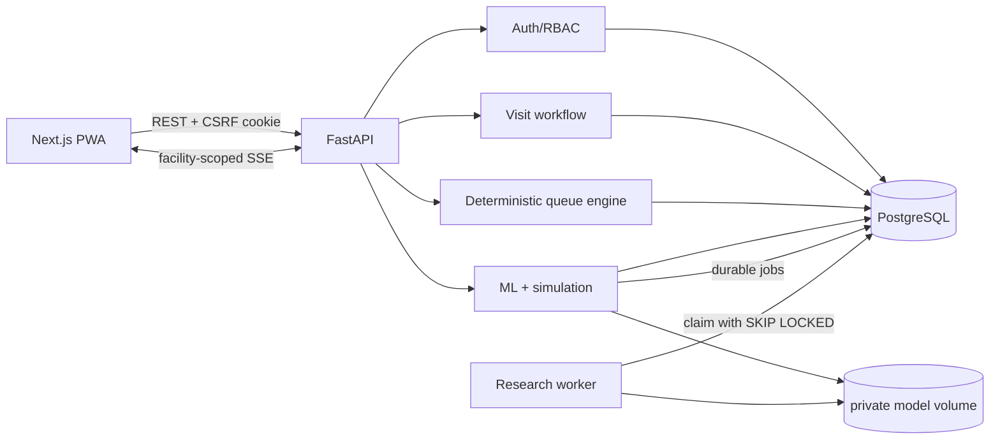

# Architecture

Hutano Flow is a research-only modular monolith. Browser clients call a versioned REST API. PostgreSQL is the source of truth. Workflow commands write domain state, append-only audit metadata and an outbox event in one transaction. Queue screens receive facility-filtered server-sent events and then refresh a restricted snapshot.

## Safety boundary

The queue engine only consumes clinician-confirmed P1–P5 labels. Model suggestions cannot write the authoritative urgency field. `ESCALATION_REQUIRED` visits are removed from routine ranking and shown for clinician-directed handling. The software does not diagnose, prescribe, or certify triage.

## Consistency boundary

Mutations accept an `Idempotency-Key`; completed keys are retained per user and endpoint. Queue calls use row locking plus a conditional state update. Concurrent stale writes return `409`. Every mutable row carries a monotonic version where required.

The command boundary locks one facility row, validates session version, hashes the request, executes the handler and commits domain state, audit/outbox and replay receipt together. In-flight retries reuse a client key; a changed body is rejected. Completed-episode corrections are separate rows with a previous-correction pointer, not updates to historical timestamps. Database triggers enforce append-only evidence for the restricted runtime role.

Heavy simulation/training is not performed while holding the facility lock. A separately deployed worker claims persisted jobs, records results/audit events, and recovers interrupted leases with bounded retries. Idempotent model versions include dataset, seed and implementation identity. API and worker share the private artifact volume; migrations and seed use a separate DDL-owner account.

SSE delivers role/facility-scoped invalidations; REST determines which details may be read. Ordered timestamp/UUID cursors handle replay. Authentication and stream-poll database sessions close before network waits. Browser polling every five seconds is the fallback; reconnection refreshes state before controls are enabled. Public-token polling uses a POST body, never the URL, and never caches its response.

SSE database polls execute in the worker-thread pool, not directly on the ASGI event loop. This keeps request cleanup runnable while a burst of clients waits for database connections; function-scoped session cleanup alone does not prevent event-loop starvation. The regression suite asserts off-loop polling and the live verification script holds 20 streams open while health and authenticated reads continue.

## Connected workspace extension

The existing authentication, command boundary, workflow engine and worker are reused rather than bypassed:

| Module | Persistent state and responsibility |
|---|---|
| `patients.py` | Longitudinal visits, structured observations, append-only encounter notes and acknowledged handovers; role-filtered clinical details |
| `resources.py` | Rooms, staff shifts, timed blocks, active reservations and snapshot-bound proposals; service calls/starts invoke reservation guards |
| `operational_prediction.py` | Private operational model artifacts, chronological calibration/evaluation, recorded-duration estimates and observed-day forecasts |
| `experiments.py` / `simulation/experiments.py` | Immutable scenario versions, durable experiment runs, finite-day replay and paired resource-assignment comparisons |
| `workspace_contracts.py` | Typed read contracts exported into the generated TypeScript schema file |

Migration `20261025_0003` adds ten facility-scoped tables. PostgreSQL partial unique indexes constrain active episode/room/staff reservations; append-only triggers protect observations, notes and scenario versions. A reservation and queue call commit together. Completion/transfer/no-show/cancellation release the reservation in the same command transaction. Research execution remains outside the facility lock.

The live heuristic uses recorded population room history with an explicit insufficiency fallback; the simulator uses configurable synthetic room-speed assumptions. These are separate operational/research mechanisms, not a claim that a simulated result validates the live heuristic. See ADR-017–021 and [the enhanced demonstration](ENHANCED_DEMO.md).

## Research workbench extension

`research_workbench.py` exposes `/api/v1/research/workbench` through the existing authenticated, facility-locked command boundary. Migration `20261026_0004` adds six tables for immutable protocols/cases, blinded reviews, consensus, participant trials and durable study runs. A partial unique index permits one active trial per protocol/participant. PostgreSQL triggers preserve protocols/references and completed evidence; typed response envelopes are generated into the web client from OpenAPI.

`ml/pipeline.py` and `ml/reliability.py` separate advisory fitting, selection, calibration, abstention selection and final testing. Private artifacts retain research evidence; display sanitisation removes class-identifying output when advice abstains. Shadow inference is private until the participant's independent response commits. Only research/admin roles receive cross-participant aggregates and monitoring. Exports omit consent references, participant identifiers and individual response text.

The `RESEARCH_OPERATIONS` worker job checks its protocol/configuration hash and invokes the pure `ml/operations_study.py` engine outside the command lock. Results, failures and lease recovery are persisted. This supporting consultation-stage simulation predicts waiting and compares equal-paid-budget schedules; it does not call live patient, queue, model-lifecycle or schedule commands. The existing whole-journey experiment remains separate. `ResearchWorkbench.tsx` connects protocol, review, participant, monitor, job and export workflows to these real endpoints.

