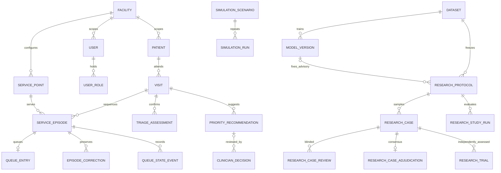

# Data dictionary

`demo_sessions` (migration `20261030_0005`) records fictional rehearsal provenance:
UUID, facility FK, generator version, UTC anchor, seed, manifest JSON and creation
time. PostgreSQL rejects updates/deletes. The manifest lists only generated case
IDs, scenario descriptions, preparation jobs and explicit fiction/method labels;
it contains no status-token secrets or fabricated participant responses. Clinical
case identities are excluded from research-role snapshot responses. A new
rehearsal appends a new session; it never rewrites an earlier preparation.

All timestamps are stored in UTC and displayed in `Africa/Harare`. Operational rows are facility-scoped. UUIDs are internal; `public_token` is a short display number and is never accepted alone for public lookup.

| Entity | Purpose | Sensitive or safety-relevant fields |
|---|---|---|
| `facilities` | Demo site and timezone | `demo_mode` startup boundary |
| `users`, `user_roles` | Staff identity, Argon2id credential and RBAC | password hashes never leave API; role checks are server-side |
| `patients` | Minimal synthetic person record | no national ID, address or contact required |
| `visits` | One outpatient journey | opaque lookup secret stored only as SHA-256; state/version controls |
| `service_points` | Rooms/desks, capacity and outage | capacity zero pauses ordinary calls |
| `service_episodes` | Sequence of stage attempts | completed rows are immutable at the database boundary; UTC timestamps, pause duration and state/version |
| `episode_corrections` | Append-only correction to completed timestamps | original/effective values, actor/reason; previous correction ID guards concurrent revisions |
| `queue_entries` | Per-stage queue state | manual pin, rank, policy version and optimistic version |
| `triage_assessments` | Authoritative clinician-entered P1–P5 | never written from model inference |
| `observations` | Optional configured research inputs | values excluded from audit and public/SSE payloads |
| `priority_recommendations` | Advisory algorithm/model output | always `requires_clinician_review` |
| `clinician_decisions` | Accept/reject/override evidence | final clinician category and rationale |
| `queue_policies` | Versioned inspectable policy | ageing limited within urgency groups by default |
| `queue_state_events` | Durable workflow transition history | actor, old/new state and server time |
| `audit_events` | Append-only security/research evidence | hashes and safe metadata; no raw observations |
| `event_outbox` | Reliable restricted live updates | minimum necessary identifiers/state only |
| `idempotency_records` | Safe network retry | actor + endpoint + client key unique |
| `datasets` | Research provenance and quality report | source/legal-basis note, hash, missingness, synthetic flag |
| `model_versions` | Versioned private artifact registry | feature/dataset hashes, metrics, review/activation lifecycle; no uploaded pickle files |
| `simulation_scenarios`, `simulation_runs` | Reproducible comparison | full parameters, policy, seed, replications and results |
| `research_feedback` | Consented task/usability observations | pseudonymous role group and consent reference |
| `jobs` | Extensible background work ledger | status, attempts and safe error summary |
| `research_protocols` | Frozen question/design/dataset/model/case/operations configuration | facility, author, configuration hash; immutable; not external preregistration |
| `research_cases` | Seeded final-partition predictor snapshots | hidden generator reference; snapshot hash excludes identifiers and outcome predictors |
| `research_case_reviews` | Two independent blinded reviews | unique case/reviewer; own label only until eligible consensus; immutable |
| `research_case_adjudications` | Two-reviewer consensus reference | unique case; author must be an original reviewer; immutable; not clinical ground truth |
| `research_trials` | Consented manual/advisory/explanation/shadow tasks | private inference, participant/consent reference, independent response; one active task per protocol/participant; completed rows immutable |
| `research_study_runs` | Durable supporting waiting/planning results | protocol/hash binding, status, results and failure summary; completed rows immutable |

## State invariants

- An active visit cannot have two ordinary episodes in `IN_SERVICE`.
- Consultation queue eligibility requires a clinician-confirmed urgency.
- `ESCALATION_REQUIRED` is excluded from routine ranking.
- Queue entry state and service episode state move together in one transaction.
- Stale row versions fail with HTTP 409.
- Model suggestions cannot write `triage_assessments.configured_urgency`.

## Core entity relationships

`audit_events`, `event_outbox` and `jobs` use typed/polymorphic object references, not foreign keys to every possible aggregate. Application authorization derives facility IDs from the session rather than trusting caller-supplied facility IDs. Partial indexes prohibit a duplicate active visit, duplicate active visit/stage, or two in-service episodes. The frozen initial migration and subsequent guard/index migration are independent of later ORM edits.

