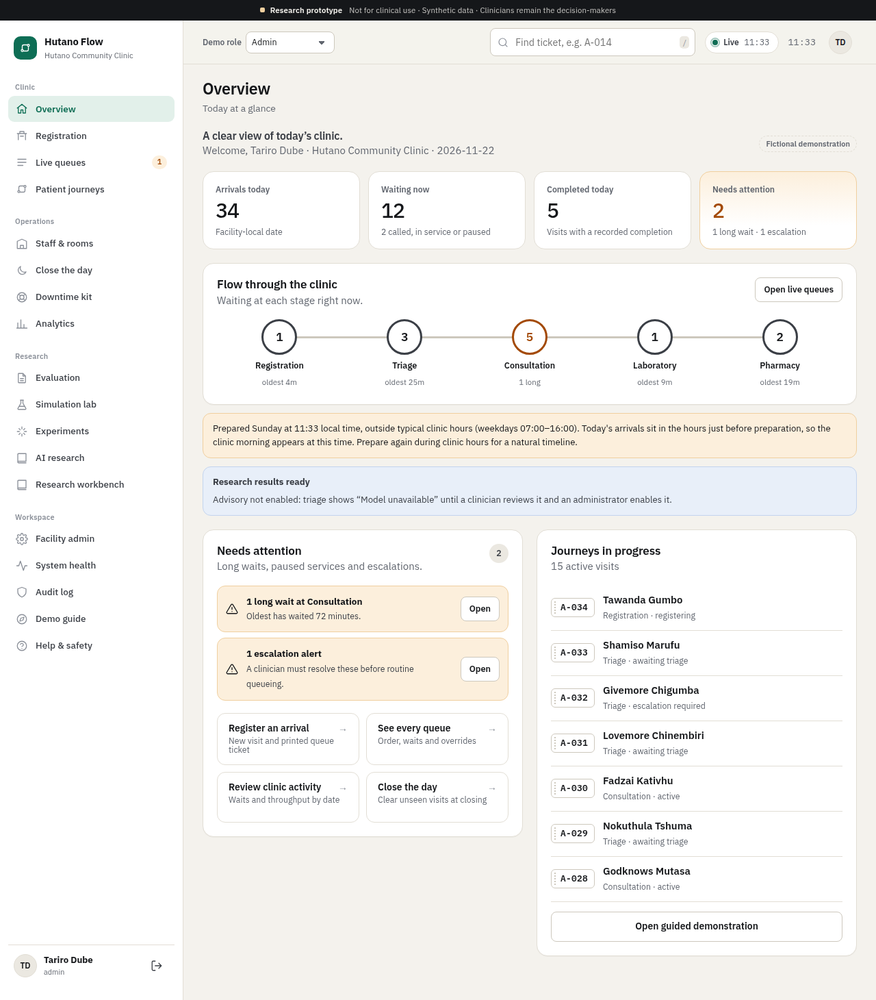
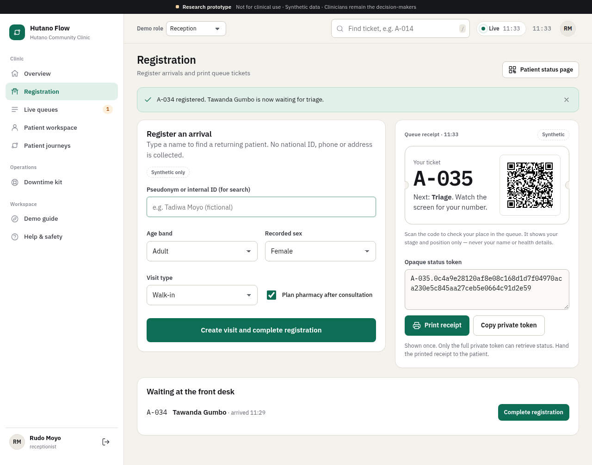
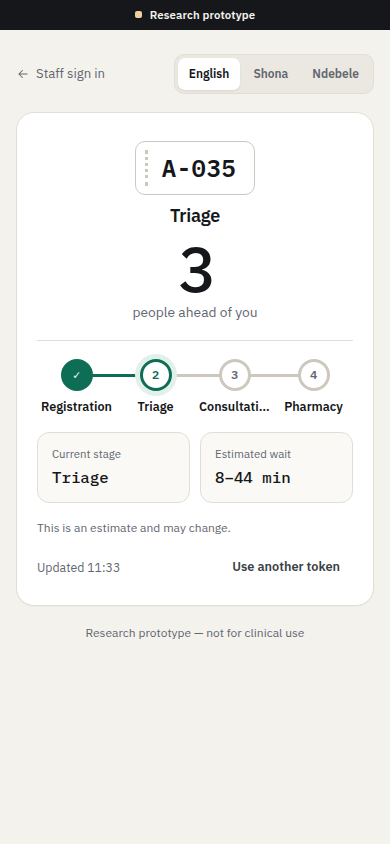
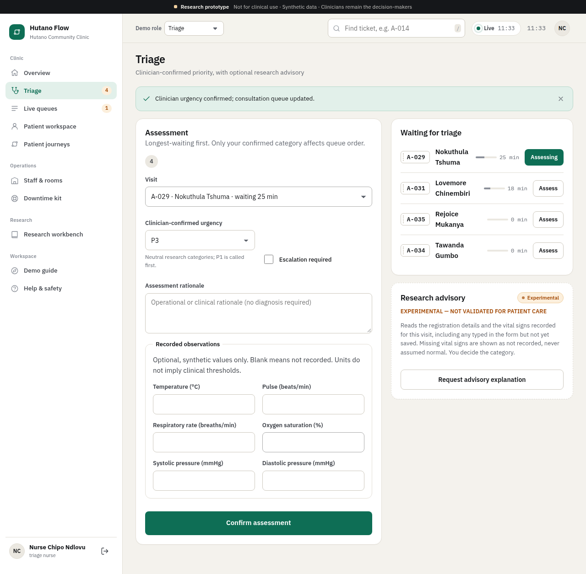
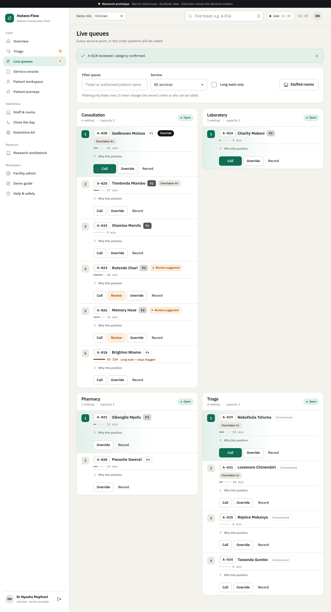
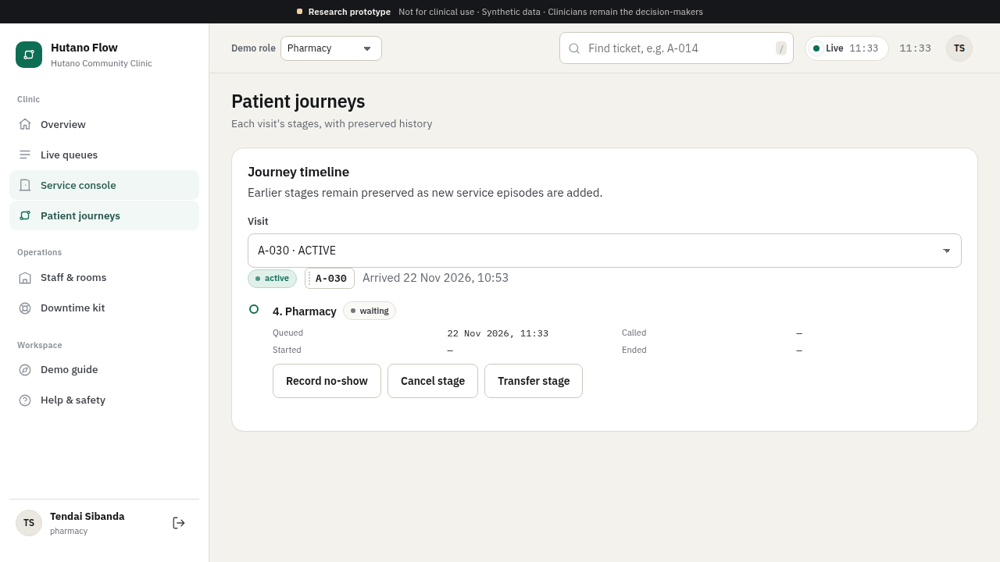
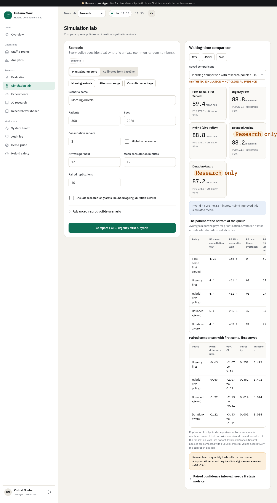
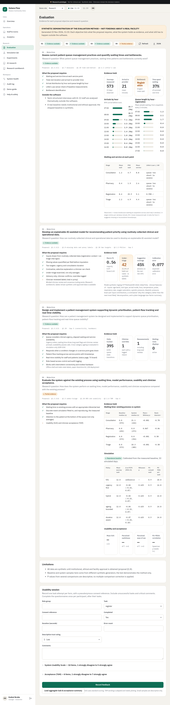

# Hutano Flow — defence demonstration script

**Smart Healthcare Queue Optimisation and Patient Management System Using AI-Assisted Prioritisation**
Michelle Sambawamedza · R231851H · BBMIT · Catholic University of Zimbabwe · Supervisor: Mr Tandavara

This script takes you through demonstrating and defending the system, one click at a time. You
don't need technical knowledge to follow it. Every click is written out, with what it does
and what you should see afterwards. The same sequence is run automatically by a browser test
(`apps/web/tests/e2e/defence-walkthrough.spec.ts`), so every step is known to work.

**How each step is laid out**

| Label | Meaning |
|---|---|
| 👤 **Be:** | Which staff member you are for this step, and how to switch |
| 🖱 **Click:** | Numbered actions. **Bold words** are exactly what is written on the screen |
| ➜ | What happens after that click, in plain words |
| 🗣 **Say:** | What to tell the panel, in your own words |
| ✅ **Check:** | What must be on screen before you move on |
| 🎯 **Why:** | Which objective or research gap this step proves |

Time: about 30 minutes of demonstration, then questions. If you have only 15 minutes, do the
steps marked ★ and skip the rest.

---

## Part 0 — The one idea to defend

The panel will remember one sentence. Make it this one:

> **"Prioritising a queue does not make the average patient wait less. It changes *who* waits.
> So I built a system that keeps clinicians in charge of urgency and measures the cost to the
> patient at the bottom of the queue. I did not hide that cost behind an average."**

Everything in the demonstration supports this sentence. It is also what the literature gap in
your proposal (§2.3, gap four) asks for: attention to *"the individual patient who ends up at the
bottom of a priority queue … rather than treating an improved average waiting time as
sufficient evidence."*

Three honesty rules. Breaking any of them is the fastest way to lose a distinction:

1. **Everything is synthetic.** No real patients, no fieldwork yet, no recruited clinicians.
   Say so before the panel asks.
2. **The AI is advisory and experimental.** It never sets a category. It is not clinically
   validated, and the system says so on every screen where it appears.
3. **Report results as they are.** The headline queue result is "no change in the average,
   and a large change in fairness". It is not "the system cut waiting time by X%".

---

## Part 1 — Finding your way around the screen

Spend ten minutes on this before your first rehearsal. Afterwards every instruction in the
script will make sense.

### The five areas of every page

1. **The black strip at the very top.** It always reads *"Research prototype · Not for
   clinical use · Synthetic data · Clinicians remain the decision-makers."* You never click it.
   It's there so nobody can mistake the demo for a real clinical system.
2. **The left menu.** This is how you move between screens. It's grouped under small grey
   headings: **Clinic**, **Operations**, **Research** and **Workspace**. Click a name, such as
   **Live queues**, to open that screen. *The menu changes with the role you're playing:* a
   receptionist doesn't see research screens, and a researcher doesn't see patient screens.
   If a screen named in this script is missing, you're in the wrong role (see point 3).
   A small number next to a menu item (for example **Triage 3**) counts people waiting there.
3. **The top bar.** From left to right:
   - **Demo role** — a drop-down menu. *This is how you become a different staff member.*
     Click it and choose, for example, **Reception**. The page reloads and you are now that
     person. The welcome line on **Overview** shows who you are, for example *"Welcome, Rudo
     Moyo"*.
   - **Find ticket, e.g. A-014** — a search box. Type a ticket number to jump to that patient.
   - **Live 09:41** with a green dot — the screen is connected and updating by itself. If it
     turns grey, the connection has dropped.
   - The clock, and a circle with initials (for example **RM**). That circle is the account
     menu; you won't need it today.
4. **The page title**, for example **Live queues**, with one line explaining the screen.
5. **The work area** below the title: cards, lists and buttons.

### Three things that will pop up

- **A message bar** under the page title. Green with a tick means it worked (*"A-177 called
  to Consultation room 2."*). Red means it didn't, and the message says why in plain words.
  Click **×** to close it.
- **A dialog box**, a small window in the middle of the screen that greys out the rest. It
  asks you to confirm something, and often asks for a **Reason**. *Every important action
  needs a short reason; this is how the system keeps its audit trail.* Type a few words, then
  press the main button (for example **Confirm action** or **Assign room & call**). **Cancel**
  closes it and nothing happens.
- **A "Why this position" line** under a patient in a queue. Click it to open the
  explanation; click it again to close it.

### The people in the demo

**Staff (you switch between them with Demo role):**

| Demo role | Fictional person | What they do |
|---|---|---|
| Reception | Rudo Moyo | Registers arrivals and prints tickets |
| Triage | Nurse Chipo Ndlovu | Takes vital signs and confirms how urgent each patient is |
| Clinician | Dr Nyasha Mupfumi | Sees patients in Consultation room 1; reviews and overrides the queue |
| Second clinician | Dr Farai Banda | Works in Consultation room 2 |
| Laboratory | Ruvimbo Chirwa | Does blood tests |
| Pharmacy | Tendai Sibanda | Gives out medicines |
| Research | Kudzai Ncube | Sees analysis and results, never patient names |
| Admin | Tariro Dube | Prepares the demo, switches the AI on or off, changes room availability |

**Patients you will use** (all fictional; full list on **Demo guide**): Tawanda Gumbo (just
arrived), Shamiso Marufu (sick 3-year-old, waiting for triage), Brighton Nhamo (has waited
over an hour), Takudzwa Madziva (consultation paused), Fadzai Kativhu (with the doctor now),
Charity Makoni (at the laboratory), Sibongile Mpofu (at pharmacy).

### Words you will use, in plain language

| Word on screen | What it means |
|---|---|
| **Ticket number** (A-014) | The short number a patient is called by, like at a bank |
| **Private token** | A long secret code on the receipt. It lets the patient check their place on their own phone. Nobody else can use it |
| **P1 … P5** | How urgent a patient is. P1 = see immediately, P5 = can wait longest. *Only a clinician sets it* |
| **Queue / Live queues** | The waiting lines, one per service point, in the order patients will be called |
| **Service point** | A place patients go: Registration, Triage, Consultation, Laboratory, Pharmacy |
| **Call** | Tell the patient it's their turn (their number appears on the waiting-room screen) |
| **Start service / Complete & route** | The patient is now being seen / finished here and sent to the next place, or home |
| **Staffed room** | A room with a staff member on duty. Calling reserves one for the patient |
| **Review suggested** | The system thinks a clinician should look at this patient again (waited long, or many were seen before them) |
| **Override** | A clinician moves a patient to a different place in the queue, with a reason |
| **Advisory** | The AI's *suggestion* about urgency. It can only suggest, never decide |
| **No suggestion (abstains)** | The AI declines to suggest because it isn't sure. That's a safety feature |
| **Simulation** | The computer runs hundreds of imaginary clinic mornings to compare queue rules fairly |
| **FCFS** | First come, first served: today's usual way |
| **Mean / P90 / 95th percentile** | Average / the wait that 90% (or 95%) of patients stay under, i.e. the long waits |
| **Audit log** | The permanent record of who did what, when and why |

---

## Part 2 — Before the defence

### The day before: rehearse once

1. **Start the system.** On the laptop, open the project folder.
   - Windows: double-click **`scripts\demo_up.cmd`**.
   - Mac/Linux: open a terminal in the folder and type `make demo`.
   ➜ A black window shows progress. Wait until it says **"Hutano Flow is running"** (a few
   minutes the first time). Docker Desktop must be running first.
2. Open **Google Chrome** and go to **http://localhost:3000**.
3. Do Part 2's "On the day" list below, then the whole walkthrough (Part 4), with a timer.
4. Fill in the ◻ boxes in Part 5 with the numbers *your* screen shows.
5. Copy the folder `docs/evidence` to the desktop. It holds a screenshot of every screen, your
   backup if anything fails on the day.

Practising leaves extra visits behind, for example the patient you register in Step 3. That
doesn't matter: the preparation on the day clears them (step 3 below).

### On the day: 30–60 minutes before

Prepare **during clinic hours** (weekdays 07:00–16:00), because the demo places today's
patients in the hours just before you prepare.

1. **Start the system** as above, and open **http://localhost:3000** in Chrome.
2. **Sign in as the administrator.**
   - 🖱 Under **Workspace**, leave **Hutano Community Clinic (fictional)**.
   - 🖱 Click the **Admin** button in the row of role buttons. ➜ Email and password fill in
     by themselves.
   - 🖱 Click **Sign in to workspace**. ➜ You see **Overview**, *"Welcome, Tariro Dube"*.
3. **Prepare a fresh clinic.**
   - 🖱 Left menu → **Workspace** → **Demo guide**. Scroll to the bottom: **Prepare a fresh
     rehearsal**.
   - Leave **"Also close visits registered by hand during earlier practice"** ✔ ticked.
   - Leave **"Enable the advisory with a scripted review"** ☐ **un**ticked. You'll switch the AI
     on live; it's one of your strongest moments.
   - 🖱 Click **Prepare fresh rehearsal**. ➜ After a few seconds: *"Fresh rehearsal ready with
     17 people in the clinic."*
   - If the message also says *"outside typical clinic hours"*, the times will look odd. Prepare
     again during clinic hours.
   - **What it really does:** cancels yesterday's unfinished patients (their records are kept),
     switches the AI off, and creates 17 fictional people at different points of a busy
     morning. It also starts the computer training the AI and running a clinic comparison in
     the background.
4. **Wait for the research results.** At the top of **Demo guide** (and on **Overview**) a box
   shows *"Preparing research results: 1 of 3 ready"*. It updates itself. ✅ Wait until it says
   **"Research results ready"**, usually 1–3 minutes.
5. **Pre-run the long comparison**, so the panel doesn't wait.
   - 🖱 Left menu → **Research** → **Simulation lab**. **Manual parameters** is already
     selected.
   - 🖱 **Scenario name:** clear it and type `Morning comparison with research policies`.
   - 🖱 **Patients:** change to `150`. Leave everything else as it is (Seed 2026, Consultation
     servers 2, Arrivals per hour 12, Mean consultation minutes 12, Paired replications 10).
   - 🖱 Tick **Include research-only arms (bounded ageing, duration-aware)**.
   - 🖱 Click **Compare FCFS, urgency-first & hybrid**. ➜ The button says *"Running paired
     replications…"*, then results appear. ✅ You can see the heading **"The patient at the
     bottom of the queue"**.
6. **Pre-run the calibrated check.**
   - 🖱 At the top of the same form, click **Calibrated from baseline**.
   - 🖱 **Scenario name:** `Calibrated baseline check`. **Simulated clinic days:** `10`.
   - 🖱 Click **Fit from baseline and compare**. ✅ *"Simulated FCFS reproduces the measured
     baseline"* appears.
7. **Record the clinician's review of the AI** (needed before the AI can be switched on).
   - 🖱 Top bar → **Demo role** → **Clinician**. ➜ *"Welcome, Dr Nyasha Mupfumi"*.
   - 🖱 Left menu → **Workspace** → **Help & safety**. Scroll to **Clinician research review**.
   - Look at the line starting **Model synthetic-logreg-…**:
     - If it ends in **EXPERIMENTAL**: click that line to open it, click **Record clinician
       research review**, type the reason `Reviewed for synthetic demonstration only`, then
       **Confirm action**.
     - If it ends in **REVIEWED**: it was reviewed in an earlier rehearsal. Nothing to do.
8. **Set up your windows.**
   - Top bar → **Demo role** → **Admin**, then left menu → **Overview**. This is **Window A**,
     your main screen.
   - Open a **new Chrome window** (Ctrl+N), go to **http://localhost:3000/status**, and make the
     window narrow like a phone. This is **Window B, "the patient's phone"**.
9. Zoom Window A so the panel can read it: **Ctrl and +** (two presses ≈ 125%). Turn off
   notifications. Close other programs.

### If something goes wrong live

Never try to fix things in front of the panel. Say the line, then move on.

| What you see | Say and do |
|---|---|
| A page is slow or blank | "That's the live database catching up." Click the menu item again, or go to the next step |
| A red message when calling: *"No staffed room is free"* | "Both rooms are busy, so the system won't double-book a doctor." Finish a patient who is being seen, then call again |
| A red message: *"…changed; refresh"* | "Someone else acted first, and the system stopped a double action." Click the menu item again to refresh, then repeat |
| A research box still says "Preparing…" | "These are real calculations, not a recording." Show the result from the day before, or the screenshot in `docs/evidence` |
| *"Model unavailable"* when asking the AI | Read the grey line under it: it says which step is missing. Usually: as **Admin** → **AI research** → **Activate reviewed advisory** (Step 5A). If it says *"not been reviewed"*, do Part 2 step 7 first. Say: "No one has approved the model yet, so it stays silent. That's the safeguard." |
| Sign-in refused | Wait 10 seconds and try again. "That's the brute-force protection working." |
| Anything else | Open the matching screenshot in `docs/evidence` and keep talking |

---

## Part 3 — Opening (3 minutes) ★

🖱 **Show:** **Window A** on **Overview**. No clicks during the opening.

**Say:**

> "In 2023, Link and colleagues followed 863 patient visits through three City of Harare
> polyclinics. On average, a patient waited **2 hours and 14 minutes** before seeing a provider.
> The biggest single block, **1 hour 14 minutes**, came before registration. The consultation
> lasted about **three minutes**. And **94%** of patients arrived in the morning.
>
> So the problem is not slow doctors. It is how patients flow through the clinic, and the fact
> that nobody, patient or staff, can see that flow.
>
> First-come-first-served is simple and feels fair, but it ignores urgency. It treats every
> consultation as the same length. It cannot react when a room closes. And patients cannot see
> where they stand.
>
> My aim was to **design, develop and evaluate** a queue and patient-management system that
> improves flow through **clinician-supervised, AI-assisted prioritisation**. I followed Peffers'
> Design Science Research Methodology: identify the problem, define objectives, build the
> artefact, demonstrate it, evaluate it, communicate it. Today is the demonstration and evaluation."

🗣 **Say** (point to the objectives on a slide or card, if you have one):

> "Four objectives:
> **O1** — measure the current process and its bottlenecks;
> **O2** — an *explainable* AI model for recommending priority from routinely collected data;
> **O3** — a system for dynamic prioritisation, patient-flow tracking and real-time visibility;
> **O4** — evaluate it against the existing process on waiting time, model performance,
> usability and clinician acceptance.
>
> I'll show each one working, then the evaluation evidence for each. I'll end with what the
> evidence does **not** show."

**Say (the safety frame):**

> "Two boundaries before I sign in. First, every person you will see is **fictional**. Ethics
> approval for fieldwork is a separate step, so I designed the system to be demonstrated and
> evaluated without real patient data. Second, the AI **never decides**. A clinician confirms
> every priority. The model can only suggest, explain, or decline to suggest."

**Why:** You set the rules of the conversation before the panel can question them.

---

## Part 4 — The walkthrough

One fictional morning at **Hutano Community Clinic**: front desk → triage → queue →
consultation → laboratory → pharmacy → home. Then you step back and show the evidence.

### Step 1 — Show the screen and its safeguards (1 min) ★

👤 **Be:** Admin (you're already signed in). **Window A**, **Overview**.

🖱 **Click:** nothing yet. Point at each area as you speak.

🗣 **Say:**
> "Across the top, on every page: *research prototype, not for clinical use, synthetic data,
> clinicians remain the decision-makers*. On the left, the screens this role is allowed to
> see. Each staff role sees only what its job needs, and the server enforces that, not just the
> screen. And this **Demo role** menu lets me play every member of staff today without signing
> out."

🎯 **Why:** The proposal (§1.10) requires role-based access and audit logging. The panel sees
both in the first minute.

### Step 2 — The whole clinic at a glance (2 min) ★

👤 **Be:** Admin. **Overview**.

🖱 **Click:** nothing. Point at:
1. **Flow through the clinic**: circles for Registration → Triage → Consultation → Laboratory →
   Pharmacy. Each shows how many are waiting and the **oldest** wait.
2. **Needs attention**: *"1 long wait at Consultation — Oldest has waited 72 minutes"* and
   *"1 escalation alert"*.
3. **Journeys in progress**: every patient, their ticket, and where they are.

🗣 **Say:**
> "Nobody in a busy clinic can see this today: who's waiting where, and for how long. These
> numbers come straight from the database and change by themselves as staff work. There's no
> refresh button."

✅ **Check:** *"15 active visits"* under **Journeys in progress**.

🎯 **Why:** Objective 3 — real-time queue visibility.

### Step 3 — A walk-in arrives at the front desk (3 min) ★

👤 **Be:** top bar → **Demo role** → **Reception**. ➜ *"Welcome, Rudo Moyo"*.

🖱 **Click:**
1. Left menu → **Clinic** → **Registration**.
2. In **Pseudonym or internal ID (for search)** type `Rejoice Mukanya`.
   ➜ If a list of **Possible matches** appears (she was registered while you practised), click
   her name. That's the system avoiding a duplicate record.
3. **Age band:** Adult. **Recorded sex:** Female. **Visit type:** Walk-in. Leave **Plan pharmacy
   after consultation** ticked.
4. Click **Create visit and complete registration**.
   ➜ A **receipt** appears on the right: a big ticket number (e.g. **A-035**), a **QR code**, and
   a long **Opaque status token**.
5. Click **Copy private token**. ➜ *"Private token copied."* (If a red message says copying
   isn't allowed, click inside the token box, press **Ctrl+A** then **Ctrl+C**.)
6. Scroll down to **Waiting at the front desk**: **Tawanda Gumbo** (twisted ankle) arrived
   earlier. Click **Complete registration** next to him.
   ➜ *"A-0xx registered. Tawanda Gumbo is now waiting for triage."*

🗣 **Say:**
> "Most queue studies assume appointments. Public clinics here are mostly walk-in, which is the
> first gap in my literature review. So the system starts where a walk-in starts: at the desk,
> with nothing booked. The patient gets a short number to be called by, and a QR code with a
> private token so they can follow their place on their own phone. The token is shown once and
> is too long to guess."

🎯 **Why:** Objective 3 and literature gap 1 (walk-in clinics).

### Step 4 — The patient's phone (2 min) ★

👤 **Be:** nobody. Switch to **Window B** (the narrow window at `/status`).

🖱 **Click:**
1. Click in **Private status token** and paste (**Ctrl+V**).
2. Click **Check status**. ➜ Rejoice's **current stage** (Triage), roughly how many people
   are ahead, and an estimated waiting range.
3. Click **Shona**, then **Ndebele**, then **English**. ➜ The page changes language.
4. *(Optional)* Change one character of the token and click **Check status** again. ➜ It is
   refused, and reveals nothing.

🗣 **Say:**
> "Research by Bidari Jafarnejad found that when patients can see the queue, the wait *feels*
> shorter than it is. So the patient gets their stage, how many are ahead and an estimate, in
> their language. And look at what it does **not** show: no name, no urgency, no one else's
> details."

🎯 **Why:** The proposal's significance (§1.5): transparent information for patients; privacy.

### Step 5 — Triage, with the AI as an adviser (5 min) ★

**Part A — switching the AI on (governance).**

👤 **Be:** **Window A** → **Demo role** → **Admin**.

🖱 **Click:**
1. Left menu → **Research** → **AI research**. Find the **Model registry** card.
2. Click **Activate reviewed advisory**. ➜ A dialog asks for a **Reason**: type `Enabled for
   the synthetic demonstration` → **Confirm action**. ➜ The card now says **"Enabled for
   synthetic advisory"**.
   *(If the button already says **Disable advisory**, the AI is already on. Skip this.)*

🗣 **Say:**
> "Before the AI can say anything, two people must act. A clinician records a review, which I
> did before we started, and then an administrator switches it on. Nobody can switch on a model
> nobody has reviewed. The governance is built into the software."

**Part B — the triage nurse assesses Shamiso.**

👤 **Be:** **Demo role** → **Triage**. ➜ *"Welcome, Nurse Chipo Ndlovu"*.

🖱 **Click:**
1. Left menu → **Clinic** → **Triage**.
2. On the right, under **Waiting for triage**, find **Shamiso Marufu** and click **Assess**.
   ➜ Her button turns green (**Assessing**) and the form on the left is now hers.
3. Scroll down to **Recorded observations** and type: **Temperature** `38.4`, **Pulse** `132`,
   **Respiratory rate** `36`, **Oxygen saturation** `96`. Leave blood pressure empty
   (children often don't have it measured).
4. On the right, under **Research advisory**, click **Request advisory explanation**.
   ➜ One of two answers appears. **Both are good.**

*If it says **"Suggests P…"**:*
> "It suggests a category, says how confident it is, and shows *which measurements pushed it
> there*. That's Miller's explanation theory: contrastive, why this category rather than the
> next, and selective, only the few factors that mattered. The empty blood pressure is listed
> as 'not recorded'. It is never assumed to be normal."

*If it says **"No suggestion — clinician assessment only"** (likely for Shamiso):*
> "This is the behaviour I'm proudest of. A breathing rate of 36 is normal for a feverish
> toddler, but it's outside what this model was trained on. So it **declines to answer** instead
> of guessing. When it does answer, it's wrong less often: 34% instead of 44%."

5. Back on the left: **Clinician-confirmed urgency** → choose **P2**. In **Assessment
   rationale** type `Fever and fast breathing; seen ahead of routine patients`.
6. Click **Confirm assessment**. ➜ A dialog says *"Confirm P2 for A-0xx — This records your
   clinician assessment, not an autonomous AI decision."* Click **Confirm clinician
   assessment**.
   ➜ Shamiso leaves the triage list and joins the consultation queue as P2.

🗣 **Say:**
> "The decision is the nurse's. Even accepting a suggestion only fills in the box; she still has
> to confirm. Her decision, the AI's suggestion, and whether she followed it are all recorded."

🎯 **Why:** Objective 2 — an *explainable* model using routinely collected data; literature gap 2
(explanations built, not promised); the proposal's rule *"The AI component ranks and explains;
it does not decide."*

### Step 6 — The queue, and the patient at the bottom (4 min) ★

👤 **Be:** **Demo role** → **Clinician**. ➜ *"Welcome, Dr Nyasha Mupfumi"*.

🖱 **Click:**
1. Left menu → **Clinic** → **Live queues**. Look at the **Consultation** card. Patients are
   numbered in the order they'll be called: the **P2** children at the top (Tinotenda, then
   Shamiso, who you just triaged), then **P3**, **P4**, **P5**.
2. Find **Brighton Nhamo (P4)**. His waiting time is in red: *"1h 12m Long wait — stays
   flagged"*.
3. Under him, click **Why this position**. ➜ The plain-language reasons for his place open.
4. Click **Review** on a patient marked **Review suggested** (for example Brighton). ➜ A dialog
   explains how long they've waited and how many later arrivals were seen first. The category
   is pre-filled. Click **Record review**.
   **What it really does:** a clinician has looked again and confirmed (or changed) the urgency.
   The warning clears, and the review is logged.
5. On **Godknows Mutasa (P5)**, click **Override**. ➜ Dialog *"Clinician queue override"*:
   **New rank** `1`, **Reason** `Only needs a repeat prescription; seen quickly between patients`
   → **Confirm action**. ➜ He moves to the top with an **Override** badge.

🗣 **Say:**
> "The order is the clinician's urgency first, then waiting time within each urgency. The
> software never changes anyone's category.
> Brighton is the patient my fourth research gap is about. He's waited over an hour while
> seven later arrivals went before him. A system that only reports the *average* would never
> notice him. This one flags him and **asks a clinician to look again**. It doesn't move him by
> itself, because changing someone's priority is a clinical decision.
> And when a clinician does want a different order: one action, a reason, and it's logged."

🎯 **Why:** Objective 3 (dynamic prioritisation); literature gap 4 (the patient at the bottom of
the queue); proposal §1.5 (*"Every override is one action and every override is logged."*).

### Step 7 — Consultation, laboratory, pharmacy (5 min)

**Part A — the doctor.** 👤 **Be:** Clinician (still). Left menu → **Clinic** → **Service console**.
On the left are the patients with this doctor; on the right, a **Call next** panel per service.

🖱 **Click:**
1. **Takudzwa Madziva** shows **Paused** ("he went home to fetch his clinic card"). Click
   **Resume service** → Reason `Back with his clinic card` → **Confirm action**.
2. On his card click **Complete & route**. In the dialog: **Next service** → **Finish visit**;
   **Service completion note** `Reviewed; advised and discharged home.` → **Confirm action**.
   ➜ *"Service completed and visit closed."* He's gone home.
3. **Fadzai Kativhu** (with the doctor now): **Complete & route** → **Next service** is already
   **Pharmacy** → note `Seen; to pharmacy to collect medicines.` → **Confirm action**.
4. In the **Consultation** panel on the right, click **Call next**. ➜ Dialog *"Call A-0xx to a
   room"*. **Room** lists only rooms that are free *and* have a doctor on duty. Click **Assign
   room & call**. ➜ *"A-0xx called to Consultation room 1"* (or room 2).

🗣 **Say:**
> "Calling isn't just shouting a number. The system knows which doctor is in which room, who's
> on a break and which rooms are busy. It reserves the room and the doctor in one step, so two
> staff can't call into the same room."

**Part B — the laboratory.** 👤 **Be:** **Demo role** → **Laboratory**.

🖱 **Click:**
1. Left menu → **Live queues**. In the **Laboratory** card there's **one ticket, with no name**.
   🗣 *"The laboratory sees a ticket, not a name. It only needs to know who's next, so that's
   all it gets."*
2. Click **Call** → **Assign room & call** (Laboratory room).
3. Left menu → **Service console**. On the patient's card: **Start service** → **Complete &
   route** → **Next service** → **Consultation** → note `Blood test done; back to the doctor
   with the result.` → **Confirm action**.
   🗣 *"She goes back to the doctor as a **new** consultation. The first one is never
   overwritten, so the full history is kept."*

**Part C — the pharmacy.** 👤 **Be:** **Demo role** → **Pharmacy**. Left menu → **Service
console**.

🖱 **Click:**
1. Under **Incoming service handovers**, read Sibongile's note: *"Please explain how to take
   the medicines in Shona; she prefers it."* Click **Acknowledge handover**.
2. In the **Pharmacy** panel, click **Call next** → **Assign room & call** (Pharmacy counter).
3. On the card on the left: **Start service** → **Complete & route** → **Next service**:
   **Finish visit** → note `Medicines collected; explained in Shona.` → **Confirm action**.
   ➜ *"…visit closed."*

**Part D — the journey record.**

🖱 **Click:** Left menu → **Patient journeys** → under **Journey timeline**, open the **Visit**
list and choose **Takudzwa Madziva** (finished in Part A). ➜ Every stage with **Queued, Called, Started, Ended** times.

🗣 **Say:**
> "Every click you saw was a timestamp. Researchers measure these by hand with a stopwatch in a
> time-and-motion study. Here they're recorded automatically, just by doing the work. That
> data feeds Objectives 1 and 4."

*(Optional)* Switch to **Window B**: Rejoice's page has moved on by itself.

🎯 **Why:** Objective 3 — patient-flow tracking from arrival to exit.

### Step 8 — When a room closes (2 min)

👤 **Be:** **Demo role** → **Admin**.

🖱 **Click:**
1. Left menu → **Workspace** → **Facility admin**. In the list of service points, find
   **Consultation** and click its **Change availability**.
2. Dialog *"Availability: Consultation"*: **Capacity** `0`, **Reason** `Room flooded` →
   **Confirm action**. ➜ *"Consultation availability updated and audited."*
3. Left menu → **Overview**. ➜ **Needs attention** now says Consultation is unavailable.
   Nobody has been removed from the queue.
4. Go back: **Facility admin** → Consultation → **Change availability** → **Capacity** `2`,
   **Reason** `Room reopened` → **Confirm action**.

🗣 **Say:**
> "A normal queue can't react when a room closes. Here, new calls pause, but **nobody loses
> their place**. And the third gap in my literature review was systems that need a good network
> or special hardware. This runs on one laptop with no internet. If the connection drops,
> screens say so and stop accepting actions rather than showing old information, and the
> **Downtime kit** prints a paper sheet for the outage."

🎯 **Why:** Literature gap 3 (unreliable connectivity, limited hardware).

### Step 9 — Objective 1: measuring today's process (3 min) ★

👤 **Be:** **Demo role** → **Research**. ➜ *"Welcome, Kudzai Ncube"*. The menu now has
research screens and no patient screens.

🖱 **Click:**
1. Left menu → **Research** → **AI research**. Scroll to **Anonymous baseline timing import**.
2. Click the line **Stored baseline: Fictional clinic · synthetic time-and-motion baseline**.
   ➜ It opens a report.
3. Point at: waiting and service time for each stage, the **bottleneck** (registration), the
   **morning arrival share**, the **share of time spent waiting**, and the **Little's Law** check.
4. Left menu → **Analytics** → click **Last 7 days**. ➜ The same measures from the clinic's own
   records. Point at **Export CSV**.

🗣 **Say:**
> "Objective 1 is measuring how the clinic works today. In the field study that means 300
> journeys over three weeks. Before going into a clinic, I needed the analysis ready and tested.
> So the system takes stopwatch data in an anonymous format and reports every measure my
> proposal lists. Notice the bottleneck is *registration*, the same shape Link and colleagues
> found in Harare. Little's Law is a sense-check on the data: if the queue lengths don't match
> arrival rate times waiting time, something was recorded wrongly."

🎯 **Why:** Objective 1 / research question 1; queueing theory (Little, 1961).

### Step 10 — Does it reduce waiting? The honest answer (6 min) ★ — the climax

👤 **Be:** Research (still). Left menu → **Research** → **Simulation lab**.

🖱 **Click:**
1. **Saved comparisons** drop-down → choose **Calibrated baseline check**.
   ➜ *"Simulated FCFS reproduces the measured baseline"*, with a table of measured against
   simulated times.

🗣 **Say:**
> "Before trusting any simulation, it must first reproduce the real measurements. Here it does,
> for every stage. And in this quiet clinic, about 38 patients a day, changing the order of
> the consultation queue makes **no difference**, because the delay is at registration.
> Reordering can't fix a registration bottleneck. That's a design finding, not a failure."

2. **Saved comparisons** → choose **Fictional clinic · morning queue comparison**.

🗣 **Say:**
> "Now a busy morning: 150 patients, two doctors, ten simulated days. Every rule gets the
> *identical* patients, so the comparison is fair."

Point at (they match Part 5):
- Average wait: first-come-first-served **89.4** min; urgency rules **88.8** min. Difference
  **−0.6 min**, with an interval from −2.1 to +0.8. **Effectively no change.**
- The most urgent (P1): **47 min → 4 min**.
- The least urgent (P5), worst 5%: **137 min → 461 min**.

🗣 **Say (slowly, this is the key moment):**
> "This is the most important result in my project. Prioritising **did not reduce the average
> wait**. Queueing theory predicts that: with the same doctors and the same work, changing the
> order *moves* waiting between people, it doesn't remove it.
> What it did was get the most urgent patients seen in **4 minutes instead of 47**, while the
> unluckiest routine patients went from about **2¼ hours to almost 8**. If I'd shown you only the
> average, you'd see 'no effect'. If I'd shown only P1, you'd see 'a miracle'. **Both would be
> misleading.** That is exactly why my fourth research gap matters."

3. **Saved comparisons** → choose **Morning comparison with research policies**. Scroll to
   **The patient at the bottom of the queue**.

🗣 **Say:**
> "So I tested two alternatives, **only in the simulator**, because changing the live order
> automatically is a decision for clinical governance, not for me.
> **Bounded ageing** moves a patient up one category for each period they wait, up to a limit.
> Urgent patients still wait about **5 minutes**, but the worst routine waits **halve**, from 461
> to **236 minutes**.
> **Duration-aware** ordering, quickest consultations first, gives the best average, but does
> nothing for the patient at the bottom.
> So my evidence-based recommendation is bounded ageing, subject to clinical governance. Until
> then, the live system stays clinician-confirmed."

*If asked "So what **does** reduce waiting?"*: left menu → **Experiments**. In the recorded
50-patient, 3-room experiment, sending each patient to *the next free room* cut the average
by about **18 minutes**. "Waiting falls when you change **capacity and flow**, not just order."

🎯 **Why:** Objective 4 / research question 4; queueing theory (Chapter 2.1.1); proposal §1.5
(*"rather than assuming that an improvement in average waiting time is sufficient"*); gap 4.

### Step 11 — How good is the AI? (4 min) ★

👤 **Be:** Research. Left menu → **Research** → **Evaluation**. Click the **O2** button near
the top. ➜ The page jumps to Objective 2.

🗣 **Say and point:**
> "These labels are **synthetic**, and the screen says so. These numbers show the method works.
> They don't show clinical accuracy."
- **Macro-F1 0.56**, against **0.07** for always guessing the most common category and **0.43**
  for a random forest. *"Macro-F1 counts every category equally, so a model can't look good by
  ignoring the rare urgent ones."*
- **Under-triage: 42 of 200 test cases** were placed less urgent than their label. *"That's
  the dangerous mistake. My proposal promised to report it, so here it is, and it's why the
  AI can never decide."*
- **Suggestion coverage ≈ 45%**: *"It answers about half the time; when it does, it's wrong
  34% of the time instead of 44%."*
- **Calibration error**: *"When it says 70% sure, it should be right about 70% of the time."*
> "The model was trained on earlier visits and tested on later ones, as it would be used in
> real life. The test data was never used to tune it."

🎯 **Why:** Objectives 2 and 4 (model performance); proposal §1.5 (under-triage reported
explicitly).

### Step 12 — Usability and acceptance (2 min)

👤 **Be:** Research. Still on **Evaluation**. Click **O4**, then scroll to **Usability
session**.

🗣 **Say:**
> "Usability is measured with the **System Usability Scale**, and acceptance with the
> **Technology Acceptance Model**: is it useful, is it easy to use. That's Chapter 2.1.4.
> Honestly: **no real participants have been recruited yet**. That needs ethics approval. What
> I can show is that the questionnaires, consent references and scoring are built and tested.
> On the day the sessions happen, the results appear here."

Point at **Outside the software** under each objective: interviews, approvals, fieldwork.

🎯 **Why:** Objective 4 (usability, clinician acceptance).

### Step 13 — Who did what: the audit trail, and AI off (2 min)

👤 **Be:** **Demo role** → **Admin**.

🖱 **Click:**
1. Left menu → **Workspace** → **Audit log**. ➜ Every action today, with who, when, and the
   reason. Point at your override and the AI activation.
2. Left menu → **AI research** → **Disable advisory** → Reason `Showing the clinic works without
   the AI` → **Confirm action**.
3. **Demo role** → **Triage** → **Triage** → **Assess** any waiting patient → **Request advisory
   explanation**. ➜ *"Model unavailable — clinician assessment required"*, with a line saying
   why (*"reviewed but is switched off"*) and who can switch it back on. The nurse simply
   carries on.

🗣 **Say:**
> "Every action is on record and can't be edited. And if the AI is switched off or breaks, the
> clinic keeps working. The AI is an extra, not a dependency."

🎯 **Why:** Proposal §1.10 (audit logging); the clinic must work without AI.

### Step 14 — Close (2 min) ★

No clicks. Look at the panel.

🗣 **Say:**
> "To summarise against my objectives:
> **Objective 1:** the system measures waiting and service time per stage, bottlenecks, arrival
> patterns and queue length, checks them with Little's Law, and calibrates a simulation that
> reproduces them.
> **Objective 2:** an explainable, calibrated model built on routine data that shows its
> reasons, reports its under-triage, and declines when unsure.
> **Objective 3:** a working system with live visibility for staff and patients,
> clinician-confirmed prioritisation, full journey tracking, and safe behaviour when things go
> wrong.
> **Objective 4:** a fair comparison on identical patients, showing that ordering *moves* waiting
> rather than removing it. It measures the cost to the patient at the bottom, and identifies
> bounded ageing as a fairer trade-off.
> What it does **not** show yet is real-world effect. That needs the approved field study at a
> clinic, with real staff and clinician-reviewed labels. The system is ready for that study. It
> is not ready for patient care, and it says so on every screen.
> Thank you. I'm happy to take questions."

---

## Part 5 — Numbers card (keep this in your hand)

All figures are synthetic, generated with seed 2026. Values marked ◻ depend on the preparation
date: copy them from your own screen during rehearsal.

**Context (Link, Tshimanga, Cochrane & Kasprzyk, 2023; Harare polyclinics, 863 visits)**
Arrival → provider 2 h 14 min · arrival → registration 1 h 14 min · registration → provider
49 min · consultation ≈ 3 min · dispensing < 2 min · 94% arrive in the morning.

**O1 — synthetic baseline (15 days, FCFS)**

| Measure | Seed-2026 value | Your screen |
|---|---|---|
| Journeys | 573 | ◻ |
| Bottleneck stage | Registration | ◻ |
| Registration wait, mean / P90 | 8.4 / 25.9 min | ◻ |
| Arrival → provider, mean | 21.4 min | ◻ |
| Total visit, mean | 32.7 min | ◻ |
| Morning arrival share | 89% | ◻ |
| Share of visit time spent waiting | 37% | ◻ |
| Calibrated simulator reproduces baseline | Yes, 10 of 10 checks within max(25%, 5 min) | ◻ |

**O4 — busy morning: 150 patients, 2 doctors, 10 paired replications, seed 2026**

| Policy | Mean wait | P90 | P1 mean wait | P5 95th pct | Most times a P5 was overtaken |
|---|---|---|---|---|---|
| First come, first served | 89.4 | 171.9 | 47.1 | 136.6 | 0 |
| Urgency first / Hybrid (live) | 88.8 | 235.7 | 4.4 | 461.4 | 91 |
| Bounded ageing (research only) | 88.2 | 174.6 | 5.4 | 235.8 | 37 |
| Duration-aware (research only) | 87.2 | 238.3 | 4.8 | 453.1 | 91 |

Paired difference against FCFS (mean journey wait):
- Hybrid **−0.63** min, 95% CI (−2.07, +0.82), t-test p = 0.35, Wilcoxon p = 0.49
- Bounded ageing **−1.22**, CI (−2.13, −0.31), p = 0.014
- Duration-aware **−2.22**, CI (−3.33, −1.11), p = 0.001

p-values are descriptive across 10 replications, with no correction for multiple comparisons.
Even the "significant" differences are about 1–2 minutes on a 90-minute wait.

**Staffing experiment (recorded 26 Oct; 50 arrivals, 3 rooms, 5 replications)**
Fixed room 94.2 · next available 76.7 · capacity-aware 76.5 min.
Capacity-aware − fixed = **−17.7 min**, 95% CI (−26.4, −9.0).
Capacity-aware was only 0.14 min better than next-available, and its P90 was slightly worse.

**O2 — advisory model (logistic regression, clinical features v3, synthetic labels, seed 2026)**

| Metric | Value |
|---|---|
| Held-out test rows (later in time) | 200; trained on 800 earlier |
| Macro-F1 | **0.563** (majority 0.071 · random forest 0.431 · ordinal 0.537) |
| P1 precision / recall | 0.84 / 0.65 |
| Under-triage / over-triage (against synthetic labels) | 42 / 46 of 200 |
| Abstention threshold | 0.55 |
| Coverage at threshold | 45% (95% CI 38–52%) |
| Error when answering | 34% (95% CI 25–45%), against 44% with no abstention |
| Calibration | Temperature scaling improved held-out log loss (1.01) |
| Inputs | Age band, visit type, arrival mode, arrival hour, 6 vital signs |

**Engineering (`docs/TEST_EVIDENCE.md`, 22 Nov 2026)**
150 backend tests including real PostgreSQL concurrency · 22 frontend unit tests · 13
full-browser end-to-end tests (one of them performs this whole script) · clean boot and backup/restore verified · 38 recorded design
decisions (`docs/DECISIONS.md`).

---

## Part 6 — Questions and model answers

Answer in three moves: **direct answer → evidence → limit**. Never bluff. "I don't know, but
here is how I would find out" is a strong answer.

### A. Problem, scope and contribution

**Q1. What exactly is new here? Queue systems already exist.**
> "Three things, together. First, it's built for **walk-in** clinics, where most of the
> optimisation literature assumes appointments. Second, explainability is **built and
> evaluated**: inputs, reasons, calibrated confidence and abstention, not promised in a
> discussion section. Third, the evaluation measures the **cost to the patient at the bottom of
> the queue** as well as the average. My main finding, that ordering redistributes waiting
> rather than reducing it, comes from that third point. A system that only reported averages
> could not have found it."

**Q2. Why not just use the South African Triage Scale?**
> "SATS is the regional reference, and a facility using it can enter its categories directly.
> The categories are configurable, neutral P1–P5 labels. But I'm not authorised to encode SATS
> decision rules as if the software performs triage. That is a clinical protocol, and the
> proposal says the system doesn't replace emergency triage. The software supports the triage
> decision. It doesn't make it."

**Q3. Isn't this just an electronic queue ticket system?**
> "The ticketing is the visible part. Underneath are clinician-confirmed priority ordering with
> explanations, long-wait review prompts, full journey timestamps for time-and-motion analysis,
> a calibrated discrete-event simulator, an explainable model with abstention, and an evaluation
> framework for the four objectives. A ticket system can't tell you whether reordering helped or
> who paid for it."

**Q4. Who would actually use this, and on what hardware?**
> "Reception, triage nurses, clinicians, laboratory, pharmacy and management, each with their
> own view. It runs on one ordinary laptop with Docker and no internet. Other devices on the
> clinic network can connect through a browser, including phones. That matters for my third
> gap: no RFID and no cloud."

### B. Methodology and data

**Q5. All your data is synthetic. Haven't you shown nothing?**
> "I've shown that the **artefact works and that the evaluation method works**. In Design Science
> Research, that is the build-and-demonstrate stage, and it comes before the field evaluation.
> Ethics approval for patient data is outside my control. The proposal anticipated that, and
> says no patient data before approval. So I built the system to run end to end on synthetic
> data, and every screen labels it. What I don't claim is real-world effectiveness. The day the
> baseline data arrives, it goes through the same import and the same calibrated simulation, and
> nothing needs rebuilding."

**Q6. How do you know the synthetic data is realistic?**
> "I don't claim it represents any real clinic. It is designed to have the *shape* the
> literature reports: morning-heavy arrivals, about 89% against Link's 94%; a bottleneck before
> the doctor; long-tailed consultation times. Its job is to exercise the methods, not to stand
> in for findings. The calibration step exists so that with real data, the simulator must
> reproduce what was measured before any result is believed."

**Q7. Why Design Science Research and not an experiment?**
> "Because the research question is *how can such a system be designed, developed and
> evaluated*. That is a design question, and Peffers' DSRM is built for it. The evaluation
> inside it is quantitative: paired simulation, model metrics, SUS/TAM. The interviews in the
> fieldwork add the qualitative side. That's why the proposal describes it as mixed methods."

**Q8. What about the interviews and the 300 journeys from your methodology?**
> "Those are the fieldwork stage and need approval. They haven't happened, and I don't present
> them as done. The system is the instrument for them: it already accepts anonymous
> time-and-motion data, needs 300 journeys over three weeks, records usability sessions with
> consent references, and produces the analysis."

### C. The AI model

**Q9. Macro-F1 of 0.56. Isn't the model poor?**
> "Against synthetic labels with deliberate noise, it is moderate, and I report it as moderate.
> It beats the baselines clearly: 0.07 for always guessing the most common category, 0.43 for a
> random forest. Two things matter more than the headline. It misses a third of P1 cases, which
> is exactly why it can never decide. And it **abstains** when unsure, which drops its error
> rate from 44% to 34% on the cases it does answer. I would rather defend a moderate, honest
> model than an impressive number on data I generated myself."

**Q10. Why logistic regression and not deep learning?**
> "Three reasons. Explainability: each input's contribution to the decision can be computed
> exactly, not approximated. Small data: a clinic will have hundreds or a few thousand labelled
> visits, not millions. Calibration: its probabilities can be calibrated reliably. I compared it
> with a random forest and an ordinal model. The random forest did worse, and the ordinal model
> was close. A deep model would cost explainability and gain nothing on data this size."

**Q11. How is the explanation produced? Is it SHAP?**
> "No. For logistic regression I don't need an approximation. Each feature's contribution to the
> score is exact. The screen shows the top factors and a contrast between the suggested category
> and the runner-up, which is Miller's *contrastive* and *selective* explanation. It also lists
> every input and its source, so a clinician can see if something was missing. These are
> explanations of the **model**, not medical reasons, and the screen says that."

**Q12. What is under-triage and why does it matter?**
> "Under-triage is placing a patient in a less urgent category than they should be. It's the
> dangerous error, because it delays someone who needed to be seen. Accuracy hides it. So I
> report it separately: 42 of 200 held-out cases against synthetic labels. That number is why
> the clinician confirms every category."

**Q13. Why does the model refuse to answer sometimes? Isn't that a weakness?**
> "It's a safety feature. It declines when three or more vital signs are missing, when an input
> is outside the range it was trained on, or when its confidence is below the threshold. A
> clinician gets *'no suggestion'* instead of a confident guess. The threshold was chosen on
> separate data, with the cost of an error and the cost of abstaining stated as an explicit
> engineering assumption, not a clinical one."

**Q14. How did you handle missing data?**
> "Missing vital signs are **not** filled in with normal values. That would make a sick patient
> look healthy. The model has explicit 'not recorded' indicators, missingness is reported per
> field before training, and the screen shows the clinician what was missing. That follows
> proposal §1.8. Systolic and diastolic count as one measurement, because they come from one cuff
> reading."

**Q15. Could the model be biased?**
> "Any model trained on historical records inherits their biases, and Garba et al. warn about
> exactly this. The system reports performance by slice, such as age band, and hides slices too
> small to judge (under 30 cases). It also keeps the clinician in charge. With real data, the
> slice reports are where bias would show up first. On synthetic data I can't make a fairness
> claim about real people, and I don't."

**Q16. How did you avoid overfitting or data leakage?**
> "The data is split by **time**, with tied timestamps kept together: earlier visits for
> training, later ones for testing. Fitting, model selection, calibration, threshold choice and
> the final test each use separate data. The final test was never used to tune anything."

**Q17. What labels would you use in a real clinic?**
> "Clinician-assigned triage categories where they exist. Where they don't, proxy labels from
> recorded fields, with a sample independently reviewed by a clinician, which is proposal §1.8.
> The Research workbench already supports blinded independent review by two reviewers, with
> consensus. The model evaluation then reports which kind of label it was tested on."

### D. Queue policy and simulation

**Q18. Your hybrid policy didn't reduce waiting time. Didn't you fail Objective 4?**
> "Objective 4 is to **evaluate** against the existing process, not to guarantee an improvement.
> The evaluation found something real: prioritisation reduced the most urgent patients' wait
> from 47 to 4 minutes, didn't change the average, and the least urgent paid for it. Queueing
> theory predicts that, through the conservation law. Reporting it is what proposal §1.5 asks
> for. And the evaluation also found what *does* move the average: pooling rooms and fixing
> capacity, about 18 minutes in the staffing experiment."

**Q19. Why are "hybrid" and "urgency-first" identical in the results?**
> "Good catch. The live hybrid policy ages patients **within** their confirmed category. Within a
> category, ageing gives the same order as first-come-first-served, so in the simulator it equals
> urgency-first. Ageing **across** categories, the research arm called bounded ageing, is a
> different policy. I kept it out of the live queue on purpose, because moving someone up a
> category on a timer is a clinical decision. Live, the hybrid adds the review prompts, reasoned
> overrides and missed-call handling that the simulator doesn't model."

**Q20. How do you know the simulation is valid?**
> "Two checks. First, the calibrated simulator must reproduce the measured baseline, every stage's
> average and 90th-percentile wait, within max(25%, 5 minutes) before any policy result is shown.
> If it doesn't, the screen says *'does not reproduce'*. Second, controls: a scenario where
> every patient has the same urgency shows no difference between policies, as it must. And every
> policy sees identical simulated patients, so differences come from the policy, not luck."

**Q21. Why only 10 replications? Are your p-values meaningful?**
> "Ten paired days. Because each pair uses the same patients, the paired differences are precise.
> The confidence intervals are narrow, about ±1.5 minutes. I treat p-values as descriptive, and
> the screen says no multiple-comparison correction is applied. The interpretation rests on the
> effect sizes and intervals: 1–2 minutes on a 90-minute wait is practically nothing, whatever
> the p-value."

**Q22. What is Little's Law doing in your system?**
> "It's a consistency check on the baseline data, as in Chapter 2.1.1: average queue length
> should equal arrival rate times average wait. If measured queue lengths and measured waits
> disagree, the data collection has a problem. When a queue is too short to test, it says 'not
> assessable' instead of pretending."

**Q23. Why discrete-event simulation instead of queueing formulas?**
> "The closed-form formulas assume simple arrivals and one stage. A clinic has several stages,
> morning surges, long-tailed consultations, outages, laboratory returns and priority classes.
> A discrete-event simulation, SimPy here, handles all of that, and the calibration step ties it
> to measured data."

### E. The system and engineering

**Q24. Walk us through the architecture.**
> "A web interface in Next.js and TypeScript, a FastAPI service in Python, PostgreSQL for
> storage, and a separate worker for the heavy jobs: model training and simulations. Screens
> update live through server-sent events. Everything is packaged with Docker Compose, so one
> command starts it. The AI and simulation are separate modules. The live queue never depends on
> them."

**Q25. What happens if two staff call the same patient at the same moment?**
> "Only one succeeds. Each command carries a version number and an idempotency key, the database
> locks the row, and a duplicate or stale command is rejected with a clear message. This is
> tested against a real PostgreSQL database with simultaneous requests. No duplicate
> allocations."

**Q26. How is patient data protected?**
> "Role-based access enforced on the server: reception can't read clinical notes, and
> researchers see de-identified aggregates only. Passwords are hashed, sessions expire when idle,
> and accounts lock after repeated failures. The patient's status token is a keyed secret, never
> stored in plain text and never in a URL. Audit records are append-only. The application runs as
> a restricted database account, ports are bound to the local machine, and backups are encrypted.
> This follows the Cyber and Data Protection Act's principles of minimisation and security. A
> formal compliance assessment would be part of any real deployment."

**Q27. What if the power or network goes down?**
> "Staff screens show they're disconnected and pause actions, so nobody acts on stale data. The
> Downtime kit prints a paper sheet, and visits are back-entered later with their real times and
> marked as back-entered. When the service comes back, everything is recovered from the
> database. Backups and restores are tested."

**Q28. Can it connect to national systems?**
> "There's a FHIR-shaped export for interoperability, but full integration with national health
> information systems is out of scope, as the proposal states. FHIR conformance would need
> formal validation against a target version."

**Q29. How did you test it?**
> "150 backend tests, including concurrency on a real PostgreSQL database; 22 frontend unit tests;
> 13 end-to-end browser tests that drive the real system, one of which performs this entire demonstration, including the full patient journey,
> the private token page, offline behaviour and the evaluation view. There is also a fresh-machine
> boot test, which starts from nothing and restores a backup. The evidence report links each
> acceptance criterion to its test."

**Q30. How does it scale to a bigger hospital?**
> "It's designed for a single outpatient facility, which is the proposal's scope. Commands are
> serialised per facility, which is deliberately conservative: correctness over throughput.
> That's comfortable for hundreds of visits a day. A large hospital would need a review of that
> choice and load testing. I'd present that as future work, not a claim."

### F. Ethics, safety and responsibility

**Q31. If a patient is harmed, who is responsible?**
> "The clinician, as now, because the clinician makes every priority decision. That's
> deliberate. The system never sets a category, recommendations are clearly labelled
> experimental, and every decision records who made it and whether a suggestion was accepted.
> Any real deployment would also need a clinical safety case and approval, which the proposal
> states in §1.8."

**Q32. Won't staff just click 'accept' on whatever the AI says (automation bias)?**
> "That's a real risk, and the design pushes against it. Accepting only pre-fills the box: the
> clinician still confirms. The model abstains on uncertain cases, so it can't be relied on for
> everything. The explanation shows *why*, which invites disagreement. And the system can record
> how often suggestions are accepted, which is exactly what the shadow-evaluation tools in the
> Research workbench are for, measuring trust without exposing patients."

**Q33. Is it ready to deploy in a clinic tomorrow?**
> "No, and it says so on every screen. It is ready for the **approved field study**: baseline
> measurement, usability sessions and clinician review of labels. Deployment for patient care
> would need ethics approval, a clinical safety case, validation on real labelled data and
> governance sign-off."

### G. Reflection

**Q34. What would you do differently?**
> "Start the ethics application earlier, so real baseline data could shape the model. And I
> would have measured the conservation trade-off before designing the live policy. It changed my
> recommendation from 'prioritise' to 'prioritise with bounded ageing, under governance'."

**Q35. What is your main limitation?**
> "Real-world evidence. Everything is shown on synthetic data from one fictional clinic. The
> methods are tested, but the effect sizes are conditional on assumptions I made. The second
> limitation is single-site generalisability, which the proposal already acknowledges."

**Q36. What is the future work?**
> "1. The approved fieldwork: three weeks, 300 or more journeys, 8–12 interviews.
> 2. Retrain and recalibrate on clinician-reviewed labels.
> 3. Usability sessions with real staff, using the SUS and TAM instruments already built.
> 4. A governance review of bounded ageing as a live option.
> 5. Load testing for larger facilities."

### Questions you should not try to "win"

If a panel member pushes on a real limitation, **agree first**, then show it is handled:

> "You're right that [limitation]. That's why the system [label / abstention / clinician
> confirmation / calibration check]. In the field study I would [specific next step]."

---

## Part 7 — How each objective is evidenced (for your examiners' checklist)

| Objective / RQ | Shown live in | Evidence and where to find it |
|---|---|---|
| O1 / RQ1 — current practice, waiting times, bottlenecks | Steps 7, 9 | Baseline report: per-stage waits, bottleneck, morning share, Little's Law; Analytics + CSV export; ADR-035 |
| O2 / RQ2 — explainable AI from routine data | Steps 5, 11 | Advisory with inputs, sources, factors and abstention; model metrics, under-triage, calibration; ADR-033, ADR-023 |
| O3 / RQ3 — dynamic prioritisation, flow tracking, visibility | Steps 2–8 | Live queues, review prompts, overrides, journey timelines, patient status page, outage handling; ADR-034 |
| O4 / RQ4 — waiting time, model, usability, acceptance against existing process | Steps 10–12 | Calibrated simulation reproducing the baseline; paired policy comparison with fairness; model evaluation; SUS/TAM instruments; Evaluation view; ADR-036 |
| Clinician authority (§1.5, §1.7) | Steps 5, 6, 13 | Category always human-confirmed; one-action logged overrides; AI disable leaves triage working |
| Gap 1 — walk-in settings | Step 3 | Walk-in registration, morning-surge baseline |
| Gap 2 — explainability built | Step 5 | Exact factor contributions, contrast, inputs and sources |
| Gap 3 — connectivity and hardware | Step 8 | Offline labelling, downtime kit, single laptop, no RFID or cloud |
| Gap 4 — patient at the bottom | Steps 6, 10 | Long-wait review prompts; per-category tails and overtaking; bounded-ageing comparison |
