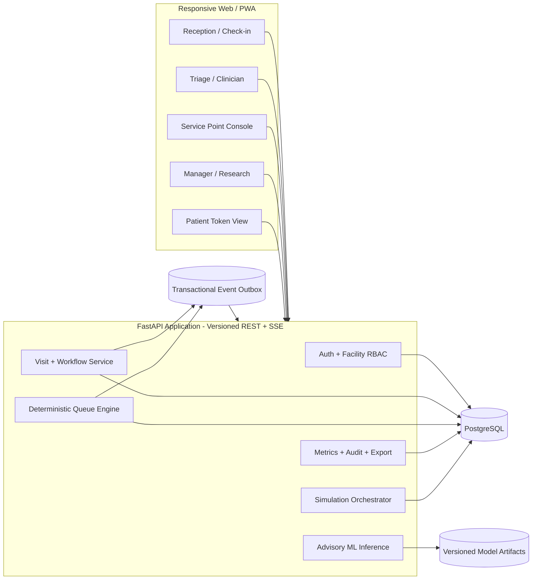

# SMART HEALTHCARE QUEUE OPTIMISATION AND PATIENT MANAGEMENT SYSTEM
## Complete AI-Agent Build Specification — Research Prototype

**Document version:** 1.0  
**Prepared:** 24 October 2026  
**Source project:** *Smart Healthcare Queue Optimisation and Patient Management System Using AI-Assisted Prioritisation* (Michelle Sambawamedza, BBMIT research proposal)  
**Deliverable:** Fully working, testable, locally deployable web-based research prototype, including queue-management workflows, clinician-supervised prioritisation, explainable AI research module, synthetic-data simulation, analytics, automated tests and documentation.  
**Safety status:** **RESEARCH AND DEMONSTRATION ONLY — NOT AUTHORISED FOR LIVE CLINICAL DECISION-MAKING.**

---

## 0. How the implementation team should read this document

### Source-of-truth hierarchy
1. **Research intent and boundaries:** Michelle's project proposal. Preserve its objectives, population, methodology and limits.
2. **This build specification:** Converts that intent into executable engineering requirements. Anything not explicitly specified in the proposal is an **implementation decision**, not a research finding.
3. **Clinical safeguards:** Never allow this prototype to replace professional triage, provide diagnosis or recommend treatment. No real-world prioritisation without separate clinical validation, ethical authorisation and facility approval.
4. **Acceptance tests:** Define whether the prototype is actually complete; attractive UI mockups alone do not satisfy this deliverable.

**Proposed objective alignment:**
- O1: Assess current queue practices, waiting times and bottlenecks → baseline flow/timestamp capture and analytics.
- O2: Develop an explainable AI-assisted model for recommending patient priority → ML pipeline, explanations, validation and clinician sign-off workflow.
- O3: Design and implement dynamic queue prioritisation, patient-flow tracking and real-time queue visibility → operational prototype.
- O4: Evaluate queue performance against the existing process using simulated outpatient waiting time → reproducible baseline-versus-proposed simulation. Additional model, usability and clinician-acceptance measures remain supporting analyses in the methodology.

**Proposal-derived requirements:** walk-in-dominated outpatient facility; one primary study site; sequential registration/triage/consultation/pharmacy service points; ~3 weeks of baseline observation targeting at least 300 completed patient journeys if approved; interviews with 8–12 staff; clinician authority; audit logs; limited connectivity; no diagnosis/treatment/prescribing; evaluation by simulation, retrospective data and controlled usability rather than live deployment.

**Engineering choices recommended here (not specified by the proposal):** Next.js/React/TypeScript, FastAPI/Python, PostgreSQL, SQLAlchemy/Alembic, SSE for live updates, Docker Compose, Pytest/Playwright, SimPy, scikit-learn. They may be changed only if equivalent functionality and acceptance criteria are preserved.

### Non-negotiable constraints
- The system starts in **DEMO/RESEARCH mode**, uses synthetic patient data by default and visibly displays `Research prototype — not for clinical use`.
- No AI-generated urgency level may be applied to a real patient's active queue without explicit authorised clinician confirmation. A model's confidence score is **not** a clinical safety certificate.
- A clinician's entered urgency category is the authoritative category used by the queue engine. A model may suggest a category with an explanation and an uncertainty flag; the clinician explicitly accepts or rejects it.
- Emergency or clinically unstable cases must be **flagged for immediate clinician-directed escalation**, not routed by an invented automatic rule. The prototype does not implement or certify emergency triage.
- No real patient data, staff identifiers, messages or health observations are sent to external LLM APIs or hosted analytics services by default.
- A synthetic-data evaluation is a **software demonstration**, not evidence of clinical accuracy or reduced real-world wait times.
- All API mutations enforce authentication, facility scoping, role-based authorisation, validation, concurrency safety and audit trails.
- Do not silently replace missing medical data with assumed normal vital signs or confident clinical predictions.

---

## 1. Product vision and success criteria

### 1.1 The problem
Walk-in patients commonly pass through several service points. Arrival times are clustered, staff have little visibility across queues, estimated waits are uncertain, and a purely first-come-first-served queue cannot represent clinician-assessed urgency. The proposal cites a Harare time-and-motion study as the motivation; those figures must **not** be hard-coded as the conditions of a new facility.

### 1.2 The product
A facility-facing application that tracks every simulated or ethically authorised patient visit as a sequence of service episodes, shows each service point's live queue, makes transparent recommendations about the next patient, allows authorised clinicians to approve or override those recommendations, and records timestamps from which waiting-time metrics can be derived. A separate research console trains/evaluates an AI suggestion model, compares alternative queue policies in simulation, and exports dissertation-ready results.

### 1.3 Successful prototype demonstration
A reviewer can start the application, sign in with seeded demo accounts, register a synthetic walk-in patient, assign a clinician-confirmed urgency category, see the patient enter the correct queue, start and end service, route the patient to the next service, watch all queues update in real time, override a recommendation with an audit reason, show a privacy-safe patient queue token, run a baseline-versus-proposed simulation and download a reproducible metrics report. All flows must work against a real database, not static JSON.

### 1.4 Scope
**IN:** single-facility walk-in registration; optional repeat synthetic visits; configurable service points and routing; clinician-entered triage/priority; explainable advisory model; dynamic queue engine; staff dashboard; patient token lookup; timestamp analytics; privacy/security controls; audit; datasets/import; simulation; data exports; automated testing; responsive web/PWA interface; basic offline tolerance.

**OUT:** emergency-department triage certification, medical diagnosis, prescribing, clinical treatment decisions, autonomous live patient prioritisation, live deployment at a Zimbabwean clinic, national EHR integration, real insurance/billing, appointment optimisation at national scale, production SMS gateways, biometric identification and nationwide multi-facility administration. A minimal FHIR-compatible export adapter is optional, not a claim of full interoperability.

---

## 2. Users, roles and permissions

| Role | Access and responsibilities | Explicit restrictions |
|---|---|---|
| System administrator | Configure demo facility, accounts, roles, service points, feature flags, queue policies, research labels and system health | Cannot silently change clinical decisions; changes audited |
| Receptionist | Register/check in patient; open visit; select requested service; view operational queue state; record arrival/check-in timestamps | Cannot confirm clinical urgency, accept AI recommendations or override clinical priority |
| Triage nurse / authorised clinician | Record triage information; set authoritative urgency category; inspect model recommendation/explanation; accept/reject; rerank with reason; redirect escalations | Never receives autonomous diagnosis/treatment advice |
| Clinician / service provider | View assigned service queue; call next; start, pause and complete consultation; route further services; override queue with reason if authorised | May view only necessary patient information |
| Pharmacy/lab service staff | View own queue, start/complete own service, route/close visit as permitted | No access to unrelated clinical notes or model administration |
| Facility manager / researcher | View de-identified flow analytics, bottlenecks, aggregate reports, simulations, model evaluation and exports | No unrestricted access to patient identifiers; research access separated from operational rights |
| Demo patient | Enter a unique opaque queue token to see own stage and approximate position | Cannot see other patients' names, ages, conditions or priority reasons |

**Access rule:** Some roles may be combined for small demo teams, but every user action must be authorised server-side. Default-deny. Scope every row and event by `facility_id` (even if only one site is seeded).

---

## 3. Workflows: exact expected behaviour

### 3.1 Facility configuration (administrator)
1. Create or seed one demo facility (e.g., `Demo Outpatient Clinic`), timezone `Africa/Harare`.
2. Create service points `Registration`, `Triage`, `Consultation`, `Pharmacy`; optional `Laboratory` and `Discharge`.
3. Set available rooms/capacity, operating hours, on-duty status, role access and default journey routes.
4. Define clinician-approved urgency labels as configurable categories. Use neutral `P1 ... P5` demo labels if clinical staff have not approved a local scale; **do not invent vital-sign thresholds, colour-based treatment times or a SATS-equivalent algorithm**.
5. Configure queue policy, maximum allowable wait warnings, estimated-duration settings, and whether AI suggestions are shown at all.
6. Log configuration changes with before/after values.

### 3.2 Patient arrival and registration (receptionist)
1. Create a **synthetic** patient, or find a permitted existing record via internal identifier.
2. Enter minimal registration data: optional pseudonym/name, age band or year of birth if needed, sex only if research dataset permits, visit type, requested services, arrival time (default current server time), contact data disabled by default.
3. System creates globally unique internal `patient_id`, a unique `visit_id`, a sequential **facility-day public token** (`A-001` style) and the first service episode.
4. Automatically timestamp `arrived_at`, `registered_at` and every subsequent status change; do not backdate silently. An authorised correction must preserve original and corrected values in audit.
5. If registration is completed and triage is required, place patient into **Awaiting Triage**; otherwise only an authorised workflow can skip triage in demo mode.
6. Show token receipt; patient receives no other patient's details.
7. Prevent duplicate simultaneously active visits for one patient unless explicitly authorised with an explanation.

### 3.3 Triage and model recommendation (authorised clinician)
1. Clinician opens a waiting visit and records the facility's required structured triage fields. Missing fields stay missing, not assumed normal.
2. If a **properly trained, reviewed model** is activated in research mode, run advisory inference and show: suggested urgency category, confidence/uncertainty indication, top contributing input factors, model version and a non-clinical warning.
3. If no validated model is available, show **`Model unavailable — clinician assessment required`**. A rule-based illustrative explanation may be available in a separately labelled *demo-only* panel; never call it a validated AI model.
4. Clinician assigns the final urgency category, optionally noting reasons; can accept/reject an AI suggestion and must actively confirm before placement in the consultation queue.
5. A concerning case can be flagged `ESCALATION_REQUIRED`, alerting staff to immediate clinician-directed handling outside routine queue calculations.
6. Persist clinician decision, model suggestion, override/accept action, actor, timestamp, model version and available rationale.

### 3.4 Queue operation at each service point
1. Every service point has a dedicated visible queue and a defined set of eligible visits.
2. `WAITING` entries are eligible; `IN_SERVICE`, `COMPLETED`, `CANCELLED`, `NO_SHOW`, `ESCALATION_REQUIRED` or not-yet-triaged entries are excluded from an ordinary consultation call.
3. The engine returns ranked **recommendations**, recomputed when an eligible visit arrives, service ends, urgency changes, queue policy changes or capacity changes.
4. Authorised staff use `Call next`; server atomically reserves an eligible entry and emits the update. Two staff clicking simultaneously must never call the same visit twice.
5. Provider starts service, pauses if appropriate, finishes, records optional non-diagnostic operational notes and routes to next service or completes the visit.
6. A referral to pharmacy/lab creates a new service episode, not an overwrite of earlier timestamps.
7. Late arrivals, no-shows, transfer, cancellation, clinician override, unavailable service point and reopened visit must have explicit state transitions and audit entries.

### 3.5 Clinician override
1. Clinician sees recommended rank and plain-language, non-diagnostic explanation (e.g., `clinician-confirmed urgency P2; waiting since 09:40; consultation room 2 available`).
2. Clinician may select another eligible entry or change a confirmed category, supplying a required structured reason and optionally a note.
3. Apply only if caller has permission. Preserve `previous_order`, `new_order`, `reason`, `clinician_id`, `occurred_at`, `policy_version`, and optional `model_version` in the append-only audit record.
4. Re-ranking cannot silently overwrite a currently in-service encounter or a manually pinned override. Any pin has defined expiry or release conditions.
5. A low-priority patient's wait warning must remain visible even if urgent patients have priority.

### 3.6 Patient token screen
- Show only **own** opaque token, current general stage, whether called/being served, approximate number ahead in that stage and optional **estimated wait range** with `Estimate only; may change`.
- Token must be sufficiently unguessable for private lookup; a short sequential display number alone is not an authentication token.
- No visible condition, triage level, age, name, model output or list of other patients.
- Updates in real time or gracefully via polling when offline; do not expose sensitive details in URLs or browser logs.

### 3.7 Service-point outage / intermittent connection
- Administrator/provider marks a room unavailable with reason and expected status.
- Its pending queue entries are reassigned only according to configured, auditable, permitted routing; otherwise paused and labelled.
- Clients display connectivity status and **last successful sync time**. Offline screens may display cached *non-sensitive* queue information but cannot silently submit clinical decisions.
- On reconnection, synchronise authorised queued non-clinical events with idempotency keys, version checks and explicit conflict resolution. Clinician priority changes require a fresh server-confirmed state before committing.

---

## 4. State model and business invariants

### 4.1 Core objects
`Patient` (minimal/pseudonymous), `Visit`, `ServiceEpisode`, `QueueEntry`, `TriageAssessment`, `PriorityRecommendation`, `ClinicianDecision`, `ServicePoint`, `User`, `AuditEvent`, `SimulationRun`.

### 4.2 Visit states
`CREATED → REGISTERING → AWAITING_TRIAGE → TRIAGED → ACTIVE → COMPLETED`

Exceptional terminal or exceptional states: `CANCELLED`, `LEFT_WITHOUT_SERVICE`, `ESCALATION_REQUIRED`. A visit can have **multiple** service episodes: registration → triage → consultation → optional lab/pharmacy → exit. The visit may be `ACTIVE` while one specific episode is `WAITING` or `IN_SERVICE`.

### 4.3 Service episode states
`PLANNED → WAITING → CALLED → IN_SERVICE → COMPLETED`; alternatives `PAUSED`, `SKIPPED`, `TRANSFERRED`, `NO_SHOW`, `CANCELLED`.

### 4.4 Invariants (must be asserted in server code and tests)
- A patient visit cannot be in two ordinary `IN_SERVICE` episodes simultaneously.
- Only one active `QueueEntry` per visit per service point at a time (unless a deliberately modelled multi-station pathway allows otherwise).
- Every queue state transition has a server timestamp, actor/service identity and audit event.
- `started_at ≥ called_at ≥ queued_at` where those timestamps exist; validate chronological consistency for corrections.
- A completed episode is immutable except through a separate audited correction mechanism.
- A patient cannot automatically receive an unconfirmed AI urgency assignment.
- No cross-facility data access, including WebSocket/SSE channels and exported reports.
- Every state-changing API request supports safe retry via idempotency token or another transactional deduplication strategy.

---

## 5. Prioritisation and queue engine

### 5.1 Queue modes
- **FCFS baseline:** earliest eligible `queued_at`, stable tie-breaker `queue_entry_id`.
- **Urgency-first comparator:** clinician-confirmed urgency first, then arrival time (used as a simulation comparator, **not** an automated clinical practice instruction).
- **Proposed hybrid research policy:** clinician-confirmed urgency plus elapsed waiting time and service availability, subject to clinician-configured safety constraints and anti-starvation warnings.

### 5.2 Safety-first algorithm design
The proposal describes a configurable weighted mechanism including urgency, waiting-time ageing and service availability. Implement this as an **inspectable, configurable policy**, not as an unvalidated clinical triage protocol.

**Recommended safe execution sequence:**
1. Fetch waiting entries eligible for this service point; ignore blocked/cancelled/in-service entries.
2. Separate entries marked `ESCALATION_REQUIRED` from routine queue; display them in a clinician alert panel.
3. Use **clinician-confirmed** urgency category as the priority anchor. Any category relationship that can be overridden by waiting-time ageing must be explicitly configured and signed off by a qualified clinical reviewer. **Default: ageing only changes order within permitted urgency groups; it must not autonomously move routine cases ahead of clinically urgent cases.**
4. For entries where the policy allows comparison, calculate a deterministic and versioned score composed of `urgency_component`, `waiting_age_component`, and `service_availability_component`. Scores and weights are **illustrative configuration**, not medical facts.
5. Predict service duration only for **capacity/ETA planning**, never as a reason to deprioritise a patient because they may take longer.
6. Stable-sort by permitted category, then policy score, then original arrival sequence/UUID tie-breaker.
7. Return recommendation + explanation and log each substantive revision. Do not persist thousands of needless per-second reorder events; audit material changes and clinician actions.
8. Clinician can override any ordinary recommendation with reason. The decision recorded by clinician takes precedence over software recommendation.

**Anti-starvation:** Track time waiting for every patient and highlight configurable long-wait alerts; optionally provide a time-dependent queue ageing factor *within clinically permitted groups*. Avoid claiming guaranteed bounded waiting time without assumptions about capacity and arrival rates.

### 5.3 Pseudocode
```python
def recommend_next(queue_entries, service_point, policy):
    eligible = [e for e in queue_entries if e.status == 'WAITING'
                and e.service_point_id == service_point.id
                and e.clinician_confirmed_urgency is not None
                and not e.escalation_required]
    scores = []
    for e in eligible:
        age_min = max(0, minutes_between(e.queued_at, server_now()))
        permitted_group = policy.allowed_priority_group(e.clinician_confirmed_urgency)
        score = policy.urgency_weight * policy.urgency_component(e)
        score += policy.wait_weight * policy.waiting_component(age_min)
        score += policy.capacity_weight * policy.availability_component(e, service_point)
        scores.append((permitted_group, -score, e.queued_at, e.id, e))
    scores.sort()  # safe group always dominates; other weights only inside allowed group
    return [explain_and_version(item[-1], policy) for item in scores]
```
No code should implement automatic diagnosis, emergency acuity assessment or hard-coded clinical cut-offs without review. Include tests showing priority order, stable tie-breaks, warnings, clinician override, identical concurrent requests and deterministic results for fixed inputs.

### 5.4 Estimated wait
Compute from queue ahead, number of available servers and measured/predicted service-time distributions; show a **range**, timestamp, and confidence/data sufficiency warning. In research mode use the simulation distribution. If unavailable, show `Estimate unavailable` rather than fabricated precision.

---

## 6. Explainable AI research module

### 6.1 Clearly separated from live queue operation
The AI service is a **research decision-support module**. It may suggest a priority label based on approved, de-identified features, but it may not directly set `clinician_confirmed_urgency`. Until real validation, mark every output `EXPERIMENTAL — NOT VALIDATED FOR PATIENT CARE`.

### 6.2 Data and features
- Data sources: authorised de-identified retrospective facility dataset, or an appropriate open outpatient/triage dataset if facility data are inadequate.
- Potential input fields **only if legitimately captured in the dataset and approved**: age band, visit type, mode of arrival, chief complaint category, recorded vital measurements, recorded referral data, date/time context and operational characteristics.
- Targets: clinician-assigned urgency or explicitly clinician-reviewed proxy label; separately, recorded consultation/service duration.
- Preserve dataset provenance, source, consent/legal basis, mapping, missingness, class distributions, exclusions and train/test leakage checks.
- Do not infer clinical labels from invented thresholds. Do not treat proxy labels as clinician ground truth.

### 6.3 ML pipeline
1. Dataset import + schema/data-quality report; reject unexpected PHI fields and malformed rows.
2. Train/test temporal holdout where source timestamps support it; otherwise disclose strategy and its limitation. Apply reproducible stratified cross-validation inside training data.
3. Compare transparent baselines (e.g., constant/majority prediction and multinomial logistic regression) with interpretable tabular classifiers (e.g., random forest or gradient boosting when justified).
4. For service duration, test a simple historical-median baseline and one regression model; evaluate MAE in minutes and optionally RMSE.
5. For urgency, report per-class recall, precision, macro-F1, confusion matrix, over-triage and **under-triage**, with any clinician-defined severity ordering. Do not select a model solely by overall accuracy.
6. Report slice metrics for age/sex **only where lawful, ethically justified, sufficiently represented and statistically meaningful**; suppress small groups to protect privacy.
7. Evaluate calibration, uncertainty and out-of-distribution/missing-feature cases; abstain to `requires clinician review` when data are poor or confidence low.
8. Generate locally computed explanations: interpretable coefficients for linear models, or SHAP/tree attributions when implemented correctly; never invent explanations by asking a general LLM to justify a prediction.
9. Save the model artifact, feature schema, training configuration, dataset hash, preprocessing pipeline, metrics, seeds and version. Maintain a model registry with states `EXPERIMENTAL`, `REVIEWED`, `RETIRED`.
10. Model recommendations still require an explicit clinician accept/reject event in the app. Never claim clinical effectiveness from simulated or proxy-labelled results.

### 6.4 Fallback demo mode
If no legitimate labelled dataset is available, the system must remain fully demonstrable: clinicians enter urgency manually, the transparent queue engine works, synthetic data drive the simulator, and the ML screen says `No validated model available`. A **sample synthetic-data classifier** may be included to test the pipeline but must be clearly labelled as a software demonstration; its metrics are not research evidence. Do not fabricate a publishable model result.

### 6.5 Model research screens
Dataset manager; train/validate job; model metrics/confusion matrix; model explanation view; feature/missingness report; model registry/version selection; prediction audit; clinician feedback analysis; simulated versus observed queue evaluation. Do not show patient-identifiable examples in research dashboard exports.

---

## 7. Architecture (recommended implementation)



### 7.1 Technology baseline
| Layer | Default selection | Why |
|---|---|---|
| Staff and patient web app | React + Next.js + TypeScript; responsive PWA | Fast CRUD/dashboard development; mobile and desktop support |
| UI framework | Accessible component library + Tailwind or equivalent | Consistent forms and keyboard navigation |
| Backend/API | Python FastAPI + Pydantic | Shared language with ML and simulation code |
| ORM/migrations | SQLAlchemy + Alembic | Versioned schema and transactional operations |
| Database | PostgreSQL | Referential integrity, indexes, isolation/transactions |
| Live state | SSE (server-sent events) with event IDs; polling fallback | Simple one-way queue updates |
| ML | scikit-learn; optional XGBoost/SHAP where justified | Interpretable tabular research models |
| Simulation | SimPy (Python) | Reproducible discrete-event simulation |
| Tests | Pytest, Playwright, TypeScript checks | Unit/integration/E2E coverage |
| Deployment | Docker Compose with pinned image/library versions | Local, reproducible student demo |
| Storage | Local private volume for synthetic/demo files | Avoid external cloud requirements |

Keep it a **modular monolith** initially: one Python API application with clean domain modules, not microservices. Simulation/training can run via a background worker process using the same codebase if jobs take more than a few seconds. No external Redis dependency is required for the MVP; use PostgreSQL job/outbox tables with reliable worker polling, or add a broker only when necessary.

### 7.2 Source repository layout
```text
smart-healthcare-queue/
  README.md
  AGENTS.md                       # short pointer to this document
  docker-compose.yml
  .env.example
  docs/
    BUILD_SPEC.md                 # this entire spec
    ARCHITECTURE.md
    DATA_DICTIONARY.md
    RESEARCH_EVALUATION.md
    THREAT_MODEL.md
    DEMO_SCRIPT.md
    DECISIONS.md
    API_OPENAPI.json              # generated
  apps/
    web/                          # Next.js + TypeScript
      src/app/(auth)/
      src/app/(staff)/
      src/app/patient/status/
      src/components/
      src/lib/
  services/
    api/
      app/main.py
      app/api/v1/
      app/auth/
      app/models/
      app/schemas/
      app/services/visit.py
      app/services/queue.py
      app/services/triage.py
      app/services/audit.py
      app/services/outbox.py
      app/ml/
      app/simulation/
      migrations/
      tests/
  packages/
    contracts/                    # JSON schema / generated TS client
  scripts/
    seed_demo.py
    generate_synthetic.py
    run_e2e.sh
  tests/e2e/
```

### 7.3 API principles
- `/api/v1` base; generated OpenAPI document and typed frontend client.
- REST for commands and queries, SSE `/events` for server-originated updates.
- UTC timestamps stored in DB; display with site timezone `Africa/Harare`.
- RFC-compatible ISO 8601 date/time, UUID internal keys, cursor pagination for activity histories.
- Strict schema validation, typed error structure, monotonic `version` on mutable queue objects for optimistic locking.
- Business transactions are atomic. Only publish an SSE event after DB commit; use transactional outbox to avoid missing events.
- Public patient-token endpoint isolated and heavily rate-limited.

---

## 8. Database specification

Use UUID primary keys unless a natural compact key is needed for a day-specific human-readable queue token. All relevant operational tables include `facility_id`, `created_at`, `updated_at` (UTC) and row `version` where concurrently editable.

| Table | Minimum fields | Constraints / notes |
|---|---|---|
| `facilities` | id, name, timezone, demo_mode, active | Seed one site |
| `users` | id, facility_id, email, display_name, password_hash, active | Argon2id or managed secure equivalent |
| `roles`, `user_roles` | role, user_id, facility_id | RBAC; many-to-many when appropriate |
| `patients` | id, facility_id, pseudonym, optional minimal demographics, synthetic_flag | No national ID or address required in demo |
| `visits` | id, facility_id, patient_id, public_token, token_secret_hash, arrival_at, registered_at, completed_at, status, visit_type | Unique public token per facility/date; distinct opaque token secret |
| `service_points` | id, facility_id, name, type, capacity, active, outage_state | Registration/triage/consult/pharmacy etc. |
| `service_episodes` | id, visit_id, service_point_id, sequence_no, status, queued_at, called_at, started_at, ended_at, clinician_id | Ordered patient journey; never overwrite prior episode |
| `queue_entries` | id, episode_id, status, joined_at, manual_pin, original_order, policy_version, version | Unique active episode/queue entry; concurrency-safe |
| `triage_assessments` | id, visit_id, assessor_id, configured_urgency, reason, assessed_at, feature_snapshot_ref | Assessor confirmed, not model-produced |
| `observations` | id, visit_id, field_code, value, unit, observed_at, source, entered_by | Configurable; consent/authorisation required |
| `priority_recommendations` | id, visit_id, queue_entry_id, algorithm_type, model_version, policy_version, suggestion, confidence, explanation_json, created_at | Advisory only; not authoritative triage |
| `clinician_decisions` | id, recommendation_id, clinician_id, decision, final_urgency, justification, decided_at | Accept/reject/override; required actor |
| `queue_policies` | id, facility_id, config_json, version, effective_at, approved_by | Audit policy versions; clinical sign-off fields |
| `queue_state_events` | id, episode_id, actor_id, from_status, to_status, occurred_at, metadata_json | Durable workflow history |
| `audit_events` | id, facility_id, actor_id, action, object_type, object_id, old_hash, new_hash, reason, occurred_at, correlation_id | Append-only; never put full sensitive clinical payload in audit |
| `event_outbox` | id, facility_id, topic, aggregate_id, payload_json, created_at, published_at | Publish events after commit |
| `datasets` | id, source_type, dataset_hash, consent_basis_note, schema_json, row_count, synthetic_flag | Research provenance; access controls |
| `model_versions` | id, model_name, version, artifact_path, feature_schema_hash, dataset_id, metrics_json, status | Immutable model artifact metadata |
| `model_evaluations` | id, model_version_id, cohort, metrics_json, executed_at | Report under-triage and uncertainty |
| `simulation_scenarios` | id, owner_id, scenario_json, source_dataset_id, synthetic_flag, created_at | Immutable scenario config after run |
| `simulation_runs` | id, scenario_id, policy, seed, replications, status, results_json, artifact_path, started_at, finished_at | Reproducibility |
| `research_feedback` | id, role_group, task_id, response_json, consent_ref, submitted_at | Pseudonymous usability/trust research |
| `jobs` | id, type, config_json, status, attempt_count, result_ref, error_summary | ML/simulation background jobs |

**Indexes:** `(facility_id, status, joined_at)` on queues; `(facility_id, arrival_at)` on visits; `(service_point_id, status)` on episodes; `(visit_id, sequence_no)` unique; `(facility_id, occurred_at)` on events; `(model_name, version)` unique; `(scenario_id, policy, seed)` on runs. Use real database check constraints/enums or validated finite state transitions; enforce uniqueness with partial indexes where appropriate.

**Data retention:** configurable retention/redaction period, secure deletion workflow, no hard delete of clinical audit without approved retention policy. Synthetic test datasets may be reset freely.

---

## 9. API contract (minimum)

Use `200` for query success, `201` for creation, `202` for accepted background jobs, `400/422` invalid input, `401` unauthenticated, `403` unauthorized, `404` nonexistent or not accessible, `409` concurrency/state conflicts and `429` throttling. Include `request_id` in error bodies.

| Method | Endpoint | Role | Expected outcome |
|---|---|---|---|
| POST | `/api/v1/auth/login` | Any user | Secure session established |
| POST | `/api/v1/auth/logout` | Authenticated | Session invalidated |
| GET | `/api/v1/me` | Authenticated | Role and facility context |
| GET/POST | `/api/v1/patients` | Reception and authorised staff | Search/create minimal patient |
| POST | `/api/v1/visits` | Reception | New visit + token + first episode |
| GET | `/api/v1/visits/{id}` | Authorised | Journey timeline and status |
| POST | `/api/v1/visits/{id}/register` | Reception | Mark registration complete |
| POST | `/api/v1/visits/{id}/triage` | Clinician | Record authoritative urgency |
| GET | `/api/v1/service-points` | Authenticated | Service point list |
| GET | `/api/v1/service-points/{id}/queue` | Staff | Queue, age, recommendation/reason |
| POST | `/api/v1/queue/{entry_id}/call` | Authorised staff | Atomic `WAITING→CALLED` |
| POST | `/api/v1/episodes/{id}/start` | Staff | Record start service |
| POST | `/api/v1/episodes/{id}/complete` | Staff | End service + optional next-stage route |
| POST | `/api/v1/episodes/{id}/transfer` | Authorised staff | New routed service episode |
| POST | `/api/v1/queue/override` | Clinician | Audited new order and reason |
| POST | `/api/v1/service-points/{id}/availability` | Manager/staff | Change capacity and trigger queue refresh |
| GET | `/api/v1/recommendations/{visit_id}` | Clinician | Advisory outcome, uncertainty and factors |
| POST | `/api/v1/recommendations/{id}/decision` | Clinician | Accept/reject with reasons |
| GET | `/api/v1/patient-status/{opaque_token}` | Token holder | Own restricted status; rate limited |
| GET | `/api/v1/events?cursor=...` | Authenticated | SSE with facility-specific events |
| GET | `/api/v1/analytics/overview` | Manager/researcher | Aggregate flow KPIs |
| GET | `/api/v1/analytics/service-points` | Manager/researcher | Wait/service/volume by stage |
| GET | `/api/v1/analytics/export` | Researcher | Privacy-safe CSV/JSON exports |
| POST | `/api/v1/research/datasets/import` | Researcher | Validate and register dataset |
| POST | `/api/v1/research/models/train` | Researcher | Background training job |
| GET | `/api/v1/research/models/{id}/metrics` | Researcher | Quality/fairness explanation |
| POST | `/api/v1/simulations` | Researcher | Launch reproducible comparison |
| GET | `/api/v1/simulations/{id}` | Researcher | Progress and results |
| GET | `/api/v1/simulations/{id}/export` | Researcher | CSV/JSON + charts + metadata |
| GET | `/api/v1/audit` | Administrator/authorised reviewer | Filtered, safe audit records |

**Sample create-visit payload (synthetic):**
```json
{
  "patient_id": "UUID_OF_SYNTHETIC_PATIENT",
  "visit_type": "walk_in",
  "initial_service_point": "registration",
  "planned_services": ["triage", "consultation", "pharmacy"],
  "idempotency_key": "UUID_FROM_CLIENT"
}
```

**Sample queue recommendation response:**
```json
{
  "queue_entry_id": "UUID",
  "status": "WAITING",
  "recommended_order": 2,
  "confirmed_urgency": "P2",
  "policy_version": "demo-hybrid-v1",
  "explanations": ["Clinician-confirmed priority P2", "Waiting 34 minutes"],
  "requires_clinician_review": false,
  "model_suggestion_applied_automatically": false,
  "queue_version": 17
}
```
Do not return patient names/clinical observations from public token APIs. Generate consistent typed schemas from OpenAPI. Every mutation must include an idempotency or optimistic-concurrency strategy and documented state requirements.

---

## 10. Real-time, offline and concurrency design

### 10.1 SSE event types
`visit.created`, `visit.state_changed`, `episode.queued`, `episode.called`, `episode.started`, `episode.completed`, `queue.rank_changed`, `clinician.override_recorded`, `service_point.capacity_changed`, `model.recommendation_ready`, `simulation.completed`.

Each event includes `event_id`, `facility_id` (server-filtered; avoid exposing it unnecessarily), `aggregate_id`, `aggregate_version`, `occurred_at` and **minimum necessary data**. Clients perform a complete restricted GET refresh if an event gap is detected.

### 10.2 Transaction/concurrency examples
- Two clinicians press `Call next` simultaneously: one succeeds; the other receives a `409` or the next different patient, **never the same queue entry**.
- Duplicate request from unstable network: processed once using the idempotency key.
- Clinician edits triage while queue updates: server verifies row version; stale action is rejected/replayed only after review.
- An SSE reconnection supplies `Last-Event-ID`; if events are unavailable, client refreshes snapshot.
- Offline cached stage display has a visible last-updated timestamp; when offline, no trusted clinical decision is committed locally.

---

## 11. Frontend design and screens

Design a polished but **functional and restrained** healthcare operations UI. High legibility, keyboard accessibility, 44px touch targets, responsive tables/cards, loading and error states, and conspicuous demo/nonclinical banner. Provide desktop-first staff dashboards and phone-friendly patient token screens. Avoid colour as the only indicator of urgency; use text labels. Never claim a recommendation is a diagnosis.

| Screen | Required interactions |
|---|---|
| Login | Role-aware authentication, invalid credentials, logout |
| Staff home | Current visit counts, average elapsed waiting, bottleneck summary, recent activity |
| Patient registration | Search/create synthetic patient, new walk-in visit, token display/print |
| Visit detail | Stage timeline, timestamps, current status, routing/actions, approved data |
| Triage station | Enter data, explicit urgency confirmation, AI advisory, accept/reject/reason |
| Queue board | One column/table per service point; sort, wait duration, filters, refresh status |
| Consultation station | Call, start, pause, complete, route, override with reason |
| Pharmacy/lab station | Own queue and start/finish workflow |
| Patient token page | Enter opaque token; see own status and ETA range only |
| Facility admin | Users/roles, service points, policy weights, approval fields, outages |
| Analytics | Waiting time by stage, service time, hourly arrivals, queue length and throughput |
| AI research | Dataset, train/validate, metrics, confusion matrix, explanation, model version |
| Simulation lab | Scenario parameters, seeds, run comparison, charts and CSV/JSON export |
| Audit log | Filter actors, events, reasons, policy/model version; privacy-safe |
| Settings/help | Demonstration disclaimer, data handling notice, keyboard help, glossary |

UI data is read from API calls, not hard-coded screenshots. Use skeletons while loading, inline validation, confirmation dialogues for safety-relevant actions, descriptive empty states, and clearly distinguish calculated metrics from simulated metrics.

---

## 12. Analytics and evaluation requirements

### 12.1 Operational definitions
- **Arrival-to-provider time:** consultation `started_at` minus visit `arrival_at`.
- **Total visit duration:** visit `completed_at` minus `arrival_at`.
- **Waiting at a stage:** episode `started_at` minus `queued_at`, with clearly declared treatment of unavailable, cancelled and called-but-no-show entries.
- **Service time:** episode `ended_at` minus `started_at`; exclude pauses or report them separately with an explicit rule.
- **Throughput:** number of completed visits per observation interval.
- **Queue length:** eligible WAITING count by service point at defined snapshot intervals.
- **Utilisation:** busy provider/room time divided by available staffed capacity time in the same interval.
- **Long waits:** configurable threshold; keep absolute and 90th-percentile waits visible, not only average.
- **Clinician override rate:** number of recommendations overridden / number of recommendations reviewed, with clear denominator and context.
- **Under-triage:** model proposes **lower urgency** than reference label based on explicitly documented urgency ordering. If labels are proxies, report agreement with proxy, **not** clinical under-triage.

### 12.2 Baseline capture
- In approved fieldwork, aim for **at least 300 completed patient journeys across three weeks** plus **8–12 staff interviews**, as the proposal states; the app can support manual anonymous time-motion entry or structured data import.
- Allow CSV imports of de-identified data with column mapping, preview, validation errors and provenance report.
- Never assume the Harare published averages are ground-truth values for another facility. Where no approved local baseline exists, use explicitly marked **synthetic assumptions**.

### 12.3 Discrete-event simulation
Implement repeatable SimPy experiments using one scenario per source distribution and a **shared arrival/service sequence across policies** (common random numbers), so differences are attributable to queue policy rather than different patients arriving in each run.

**Supported policies:** FCFS, urgency-first comparator, proposed hybrid clinician-confirmed-urgency policy.  
**Inputs:** arrival distribution by hour, service duration distributions by service point, configured number of servers/rooms, patient journey mix, urgency mix, optional room outage and high-load scenarios, wait warning thresholds, random seed, number of replications.  
**Outputs:** mean, median, P90, maximum and category-specific waiting time; arrival-to-provider time; total visit time; queue lengths; completed visits; utilisation; low-urgency long waits; per-policy distributions and uncertainty across replications.

**Research comparison:** show proposed-vs-FCFS difference (absolute minutes and percentage), paired run comparison, uncertainty interval, and methodology notes. The main outcome aligned with revised Objective 4 is **simulated outpatient waiting time**; the other measures are supporting diagnostics. **Do not hard-code or promise any percentage improvement.**

**Quality checks:** identical inputs and seeds repeat results; zero- and full-load cases; stable behaviour with no clinician labels; capacity=0; long-service tails; burst arrivals; all urgent patients; all low-urgency patients; and zero relevant data. No queue algorithm can reduce wait when staffing capacity is fundamentally insufficient in every scenario: the simulator must show losses as well as gains.

### 12.4 Research usability and acceptance
- Include guided tasks for registering, finding a patient, triaging, calling the next patient, overriding, completing visit, checking token and reading analytics.
- Record task completion, duration, errors and participant comments with consent. Optionally implement a SUS questionnaire if the study actually uses it; do not add unsupported claims about benchmark scores.
- Keep clinician-trust feedback separate from operational performance, and report both positive and negative findings.

### 12.5 Reporting/export
Exports include report title, `research/demo` label, dataset hash/type, policy/model versions, observation period, units, calculation methods, simulation parameters, random seeds, replication count and limitations. Export charts as image or SVG and raw results as CSV/JSON. No patient identifiers in aggregate exports.

---

## 13. Privacy, security and ethics

### 13.1 Legal and ethical posture
Health information is sensitive under Zimbabwe's Cyber and Data Protection Act [Chapter 12:07]. The project must obtain **separate appropriate approval and permissions before using real facility/patient data**; do not infer that a research prototype or a synthetic dataset itself authorises live operation. The legal basis, confidentiality, consent/exception rules, retention and data residency must be reviewed with competent local advisers and the relevant institutional/facility authorities. Do not present this software specification as legal or clinical approval.

### 13.2 Required protections
- Synthetic demo data by default; clear seed/reset functionality and visible synthetic flags.
- Strong password hashing; HTTP-only, secure, SameSite cookies or an equivalently secure session scheme; CSRF defence if cookie-based; session expiry and revocation.
- Secure authentication and per-facility, per-role authorisation on **every** API endpoint and server event; restrict object-level access.
- TLS outside localhost; encrypted backups/volumes for any genuinely sensitive deployment; credentials exclusively via environment/secrets, never git.
- Field-level minimisation; restrict intake to necessary data; no raw data exported to telemetry, public model endpoints or third-party AI services.
- Security logs exclude personal health content; audit retains actor, action, reference, reason and non-sensitive change hashes.
- Rate limit login, token lookup, dataset import and heavy jobs. Validate uploads (size/type/content), sanitise displayed text and protect against injection and unsafe deserialisation.
- Configurable retention and deletion/redaction, backup/restore test, database access restricted to application service; documented incident and data access procedures.
- Admin/research dashboards never display individual patient information without legitimate authorisation.
- Prevent production deployment by default: visible `RESEARCH_MODE=true`, explicit startup guard for unknown environment, seeded data only and a restrictive launch checklist.

### 13.3 Threat model questions agents must answer
Could a receptionist elevate clinical urgency? Could a token be guessed? Could a facility user access another site's visits? Could a real name appear in SSE data? Could model features leak in an audit log? Could an offline client overwrite a clinician decision? Could an unauthorised user change a queue policy? Could concurrent `Call next` lead to double service? Implement regression tests for each.

**External engineering references (not clinical certification):** OWASP ASVS and OWASP API Security Top 10; optional FHIR resource design for Patient/Encounter/Observation. Cite versions in documentation but do not claim compliance or certification without a formal assessment.

---

## 14. Optional data exchange and interoperability

Implement a **one-way, synthetic-data-only FHIR-shaped export adapter** if time permits, mapping:
- internal patient → FHIR `Patient` (synthetic/minimal),
- visit/service episode → `Encounter` (with explicit mapping caveats),
- recorded observations → `Observation`.

FHIR is a resource/exchange standard; an ad hoc JSON endpoint does not prove full FHIR compliance. Define target version (e.g., R4) and basic validation. No live external system connectors, national EMR connection, real appointments or bulk PHI export are required for acceptance.

---

## 15. Build sequence / AI-agent work breakdown

### Phase A — Bootstrap and scaffolding
**Output:** working monorepo, Docker Compose up, PostgreSQL migrations, API health check, web shell, `.env.example`, precommit/static checks and seed script.  
**Acceptance:** `docker compose up --build` starts cleanly; README provides exact commands and demo login credentials; no committed secrets.

### Phase B — Identity, facility and core state
**Output:** authentication, RBAC, demo facility configuration, patients/visits/service points/episodes, event model, migrations and permission tests.  
**Acceptance:** receptionist creates visit and token; correct event records appear; unauthorised role gets 403.

### Phase C — End-to-end manual queue management
**Output:** triage entry, clinician-confirmed urgency, deterministic FCFS/hybrid recommendations, call/start/finish/route, override/audit, service capacity changes.  
**Acceptance:** at least one complete walk-in journey works; queue ordering matches documented policy; no duplicate concurrent calls.

### Phase D — UI and real-time experience
**Output:** all staff screens, patient token view, SSE, polling fallback, offline awareness, responsive layout and robust error handling.  
**Acceptance:** two browser tabs observe queue changes; patient view leaks no private data; offline/stale state labelled correctly.

### Phase E — Research analytics and simulation
**Output:** flow metrics, aggregate visualisations, synthetic baseline generator, SimPy FCFS/urgency/hybrid comparisons, export package.  
**Acceptance:** deterministic seeded 300-visit synthetic dataset, reproducible results, clear units/assumptions, at least one scenario where proposed policy fails to improve an outcome (the engine must not bias reports toward success).

### Phase F — AI advisory pipeline
**Output:** data import/validation, separate training and evaluation, calibrated/abstaining research classifier, model versions, recorded explanations, clinician accept/reject workflow.  
**Acceptance:** demo queue works with AI disabled; model trained on a suitable dataset produces reproducible metrics and an explicit research warning; synthetic-only model never labelled clinically validated.

### Phase G — Tests, security and delivery
**Output:** full end-to-end tests, seed data, sample evaluation reports, architecture/ERD/API docs, threat model, screenshots, issue-free demo walkthrough and final README.  
**Acceptance:** `pytest` and Playwright pass; database reset works; no critical mocked buttons or TODOs; realistic failure cases are handled visibly.

### Recommended parallel agents
| Agent | Responsibility | Interface dependency |
|---|---|---|
| Tech lead / integrator | Architecture, repo conventions, milestones, PR merging, system invariants | Owns OpenAPI/schema version agreement |
| Backend/database | Migrations, workflow transactions, queue engine, audit, auth | Publishes API contract first |
| Frontend/UX | Role-based screens, token view, SSE, tests | Uses generated typed API client |
| Research/ML | Datasets, ML pipeline, explainability, registry, honest model card | Cannot bypass clinician-decision invariant |
| Simulation/analytics | SimPy, metrics definitions, experiments and reports | Uses shared event/dataset schemas |
| Security/QA | Permission tests, concurrency tests, Playwright, threat model, final acceptance | Reviews every high-risk mutation |

**Handoff rule:** Each agent must produce executable code and tests, not only diagrams, pseudocode or screenshots. The integrator verifies workflows across services after each phase. Document any changed requirement in `docs/DECISIONS.md`.

---

## 16. Acceptance criteria (Definition of Done)

The project is **not complete** until every applicable item below is demonstrated:

### Functional
- [ ] New clone boots from documented commands with a real PostgreSQL database.
- [ ] Demo accounts for all roles work; unauthorised operations fail server-side.
- [ ] One synthetic walk-in patient can traverse registration → triage → consultation → pharmacy → complete, with accurate timestamps.
- [ ] Two or more patients can queue concurrently with correct, deterministic ordering and visible wait ages.
- [ ] A clinician can view, accept/reject (when available) and override a recommendation, and audit history records what happened.
- [ ] AI service unavailable → normal queue workflow continues using clinician-confirmed urgency.
- [ ] Service point outage changes available capacity without losing state.
- [ ] Staff dashboards reflect database-backed updates without manual page reload where connected.
- [ ] Patient token reveals only own restricted queue status and cannot be enumerated cheaply.
- [ ] Queue policy switches among FCFS, urgency comparator and proposed hybrid (simulator); no automatic clinical acuity inventing.

### Research
- [ ] At least 300 **synthetic** visits can be generated reproducibly, unless an approved real dataset is separately supplied.
- [ ] Baseline metrics calculate waiting/service/arrival-to-provider times using documented formulas.
- [ ] Simulation runs each policy on the same sampled arrival/service scenarios and exports reproducible results with seeds.
- [ ] Reports include mean and P90 waiting time plus low-urgency wait warnings; no blanket claim of improved real-world wait times.
- [ ] AI model evaluation distinguishes genuine labels, reviewed proxy labels and synthetic labels and clearly names limitations.
- [ ] Outputs preserve provenance, model/policy version and explanatory factors.

### Engineering/security
- [ ] Automated unit, API/integration and E2E tests pass locally.
- [ ] Concurrent calls and duplicate commands do not create duplicate service allocations.
- [ ] Facility scoping, patient token leakage, RBAC and audit integrity are tested.
- [ ] No production PHI/secret material is committed; `.env.example` contains placeholders only.
- [ ] Error/loading/empty/offline flows exist and are comprehensible.
- [ ] Seed/reset, backup/restore demo and README instructions work on a clean machine.
- [ ] OpenAPI documentation is generated and schemas match frontend data types.
- [ ] At least one end-to-end demo video/script or screenshots show **working** screens and a completed visit timeline.

---

## 17. Mandatory demo walkthrough

1. `docker compose up --build`; show staff login and prominent prototype disclaimer.
2. Login as receptionist; register `Synthetic Patient A`, generate queue token.
3. Login as clinician; triage A, assign demo urgency P2; view optional advisory with reason; explicitly confirm category.
4. Register Patients B and C with differing clinician-confirmed categories and arrival times; show waiting-time ageing and the inspectable proposed ranking.
5. Clinician overrides one recommendation with a reason; show audit log entry and unchanged prior timeline.
6. Receptionist/provider calls next, starts and completes consultation, routes A to pharmacy; pharmacist completes; close the visit.
7. Open anonymous token page; demonstrate that only A's status is visible and that a guessed/wrong token fails.
8. Pause consultation room / make it unavailable; show the queue warning/redispatch only when configured.
9. Open analytics, display average and P90 wait by service point using synthetic measured timestamps.
10. Run simulation with fixed seed across FCFS, urgency-first and proposed hybrid; open identical-input comparison chart and export CSV.
11. Disable model inference; demonstrate full queue workflow still works. Show model-training demo separately with clear synthetic/validation warning.
12. Show automated test result and reset instructions.

---

## 18. Deliverables expected from coding agents

1. Full **source code** (web, backend, ML and simulation), with sensible modular boundaries.
2. Docker Compose orchestration, database migrations, `.env.example`, seed/reset scripts.
3. Responsive working staff/patient UI with real state-changing interactions.
4. Documented OpenAPI backend plus generated frontend types.
5. Postgres schema, indexes, database ER diagram and data dictionary.
6. Versioned clinician-supervised queue policy and explainability metadata.
7. Reproducible research/model evaluation and discrete-event simulation.
8. Security/ethics notes and clear `not for clinical use` labels.
9. Unit, integration, concurrency, permission, and Playwright end-to-end tests.
10. README with setup, demo accounts, limitations, known assumptions, test commands and troubleshooting.
11. `docs/DECISIONS.md` explaining deviations from the original proposal/build spec.
12. A final **test evidence report** showing which acceptance criteria passed, with real commands/output and links to implemented source files.

---

## 19. Unresolved decisions — do not invent research facts

- **Actual facility:** not yet specified. Build for one configurable demo clinic.
- **Available historic patient records:** unknown. Use synthetic/demo data; allow approved data import later.
- **Exact triage protocol and categories:** not specified as authorised for the intended site. Expose configurable clinician-reviewed labels rather than fake SATS decisions.
- **Research ethics/facility approval:** not established in this handoff. Never require actual patient data to demonstrate the prototype.
- **Clinical model target and acceptance thresholds:** require qualified reviewer and labelled dataset. Use explicit `not validated` state until resolved.
- **Scope of true offline editing:** proposal says offline-tolerant, not offline medical decision support. Implement safe stale-view and non-clinical retries, with clinical decisions requiring a current authenticated connection.
- **Research Objective 4:** the conversation subsequently narrowed it to simulated outpatient waiting-time comparison after a supervisor comment about double-barrelled objectives. Keep additional usability/model measures as supporting work unless Michelle's latest approved proposal says otherwise.

---

## 20. Copy/paste kickoff instructions for coding agents

> You are the software engineering team building the **Smart Healthcare Queue Optimisation and Patient Management System** research prototype. Read the attached `smart_healthcare_queue_ai_agent_build_spec.md` in full. Implement a complete, running, database-backed prototype, not a design-only deliverable. Preserve the research scope, clinical safeguards, workflow invariants, evaluation definitions, role-based permissions, and acceptance criteria. Start with a phase-by-phase plan and minimal architecture decision log, then build the application in the order in Section 15. Use a modular monolith, working migrations and seeded synthetic data, then implement and test real user journeys end to end. The queue must work without AI; AI outputs are advisory and clinician-approved, never autonomous clinical actions. Do not use real patient data, claim clinical validation, invent triage rules, or show fabricated model performance. Run tests and repair failures; provide a repeatable demo script and report each acceptance criterion as PASS/FAIL with evidence. Where a specification decision cannot be grounded in the proposal, document it as an engineering assumption rather than a fact.

---

## 21. Standards and supporting references for implementers

These are **external implementation references**, not claims that Michelle's existing proposal already specifies particular framework versions:

- Zimbabwe Cyber and Data Protection Act [Chapter 12:07]: https://zimlii.org/akn/zw/act/2021/5
- HL7 FHIR standard (optional resource mappings): https://hl7.org/fhir/ ; R4 Observation resource: https://hl7.org/fhir/R4/observation.html
- OWASP Application Security Verification Standard: https://asvs.owasp.org/
- OWASP API Security Top 10: https://devguide.owasp.org/en/07-training-education/07-api-top-ten/

**Final reminder:** A fully working **research prototype** is achievable with these requirements. Clinical effectiveness, medical-device suitability, regulatory compliance and deployment to actual facilities are **separate claims** requiring evidence, approvals and specialist review.
